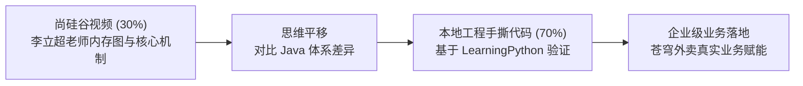
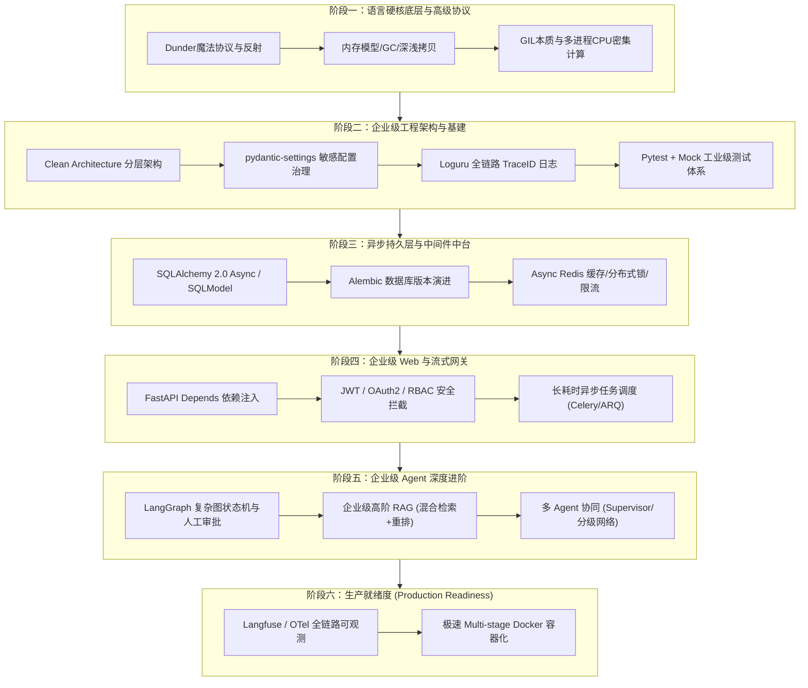

# 🏗️ 企业级 Python 架构师与深度 AI Agent 体系化进阶指南

> **适用对象**：具备成熟 Java 后端工程经验（Spring Boot、MySQL、Redis、分布式、分层架构），计划全面转型现代企业级 Python 与深度 AI Agent 研发的开发者。  
> **核心原则**：拒绝玩具级脚本（Toy Code），对标 Java 工业级标准（Clean Architecture、版本迁移、连接池治理、分布式缓存、测试驱动、全链路追踪），直击高并发、高可用与深度 Agent 生产落地！

---

## 目录
- [一、 学习周期与投入规划](#一-学习周期与投入规划)
- [二、 搭配“尚硅谷”视频脱水精读清单](#二-搭配尚硅谷视频脱水精读清单)
- [三、 整体演进全景路线图](#三-整体演进全景路线图)
- [四、 阶段一：Python 语言硬核底层与高级协议](#四-阶段一python-语言硬核底层与高级协议尚硅谷进阶精读)
- [五、 阶段二：企业级工程架构与基础设施底座](#五-阶段二企业级工程架构与基础设施底座对标-spring-boot-体系)
- [六、 阶段三：企业级异步持久层与中间件中台](#六-阶段三企业级异步持久层与中间件中台对标-mybatis--jpa--redis)
- [七、 阶段四：企业级 Web 与流式网关](#七-阶段四企业级-web-与流式网关fastapi-生产级进阶)
- [八、 阶段五：企业级 Agent 深度进阶](#八-阶段五企业级-agent-深度进阶从-toy-agent-迈向工业级自主系统)
- [九、 阶段六：生产就绪度与全链路可观测性](#九-阶段六生产就绪度production-readiness与全链路可观测性)
- [十、 学习进度打卡表](#十-学习进度打卡表)

---

## 一、 学习周期与投入规划

以具备 Java 工程师背景、每周投入 **12 ~ 15 个有效工时**（工作日 1.5~2 小时，周末集中 3~4 小时）测算：

| 阶段 | 核心模块 | 预估周期 | 累计工时 | 阶段核心交付物与里程碑 |
| :---: | :--- | :---: | :---: | :--- |
| **阶段一** | **Python 硬核底层与 OOP 协议**<br>（魔法方法族、反射、GC/内存、GIL与多进程） | 4 ~ 5 天 | 约 8 小时 | 手写支持切片索引、迭代器、上下文管理与多进程清洗的工具库 |
| **阶段二** | **企业级工程架构与基础设施**<br>（Clean Arch、pydantic-settings、Loguru、Pytest） | 4 ~ 5 天 | 约 8 小时 | 搭建工业级标准脚手架，实现带 Trace ID 的全链路日志与 Mock 单元测试 |
| **阶段三** | **企业级异步持久层与中间件**<br>（SQLAlchemy 2.0 Async、Alembic、Async Redis） | 6 ~ 8 天 | 约 12 小时 | 用异步 ORM 重构苍穹外卖，实现版本迁移控制与 Redis 分布式锁 |
| **阶段四** | **企业级 Web 与流式网关**<br>（FastAPI Depends 依赖注入、JWT/RBAC、ARQ任务队列） | 4 ~ 5 天 | 约 8 小时 | 打通安全鉴权、带事务注入的 Controller，解耦长耗时生成任务 |
| **阶段五** | **企业级 Agent 深度进阶**<br>（LangGraph 复杂图、高阶混合检索 RAG、多智能体协同） | 8 ~ 10 天 | 约 16 小时 | 交付带断点续跑、人工审批中断的完整外卖订单与企业知识库智能体 |
| **阶段六** | **生产就绪度与可观测性**<br>（Langfuse 链路追踪、Multi-stage Docker 容器化） | 3 ~ 4 天 | 约 6 小时 | 接入全链路 Token/耗时监控，构建 100MB 级轻量化安全 Docker 镜像 |

* **🔥 高强度冲刺节奏**（工作日 2~3 小时 + 周末全天）：**约 3 ~ 4 周（1 个月以内）** 即可全部通关。
* **☕ 稳健打法**（工作日 1~1.5 小时 + 周末半天）：**约 5 ~ 6 周（1.5 个月左右）** 彻底闭环。

---

## 二、 搭配“尚硅谷”视频脱水精读清单

> **观看策略**：**严禁从第 1 集傻看**。跳过初学者语法练习（Turtle海龟、猜数字、初级循环），以 **1.5 ~ 2.0 倍速定位式观看** 李立超老师讲解**底层机制与内存图**的精选集。



### 1. 必看基础神课：《尚硅谷 Python 核心基础教程》（李立超老师）
* **P72 ~ P98【面向对象与魔法方法全解析】**（🔥 必看核心）：
  * *看点*：类与对象的本质、属性绑定、封装与继承。
  * *重点集数*：`__init__`、`__repr__`、`__str__`、`__gt__` 等魔法方法以及特殊属性的作用。
* **P99 ~ P104【模块与命名空间】**：
  * *看点*：Python 模块加载机制、`__name__ == '__main__'` 的底层意义、包的导入搜索路径 `sys.path`。
* **P105 ~ P115【异常与上下文管理】**：
  * *看点*：异常捕获机制与执行链路、自定义异常。
* **P116 ~ P124【文件操作与底层 I/O】**：
  * *看点*：文件指针、缓冲区刷新、`with` 语句底层资源释放。
* 🚫 **直接跳过**：`P1 ~ P71`（环境安装、基础数据类型体验、基础循环练习直接跳过）。

### 2. 底层攻坚进阶：《尚硅谷 Python 高级 / 核心进阶特性》
* **变量与内存引用机制**：看老师画栈内存与堆内存对象绑定的图解，吃透不可变对象与浅拷贝。
* **作用域与闭包内存机制**：搞透 LEGB 规则，看闭包在外层变量被销毁后是如何通过 `__closure__` 持有引用的。
* **生成器与迭代器底层**：重点看 `__iter__` 与 `__next__` 的状态机流转。
* **装饰器原理深入**：看函数作为一等公民在内存中的传递过程。

### 3. 数据底座：《尚硅谷 Python 数据分析教程（NumPy + Pandas 篇）》
* **NumPy 核心篇（约 10~15 集）**：
  * *重点*：多维数组切片、向量点积（`np.dot`）、广播机制（Broadcasting）、范数计算（Norm）。
  * *实战价值*：手工手写余弦相似度算法，彻底吃透 RAG 向量检索底层。
* **Pandas 核心篇（约 15~20 集）**：
  * *重点*：DataFrame 创建、缺失值清洗（`dropna`/`fillna`）、列运算、`groupby` 分组聚合与统计。
  * *实战价值*：外卖业务数据报表分析 Tool，智能体自动执行统计查询。

### 4. 关键认知：关于 Agent、现代异步与微服务生态
> ⚠️ **客观事实**：传统培训机构（包括尚硅谷）的课程普遍截止于基础语法、传统 Web（Django/Flask）与传统爬虫。  
> 对于 **现代工业界生态**（`FastAPI` 异步流式、`SQLAlchemy 2.0 Async`、`Pydantic V2`、`LangGraph` 图状态机、`Langfuse` 链路追踪、`OpenAI Function Calling`），必须依靠**我们一对一实战手撕代码与官方最佳实践**攻坚！

---

## 三、 整体演进全景路线图



---

## 四、 阶段一：Python 语言硬核底层与高级协议（尚硅谷进阶精读）

> **心智对齐**：彻底搞懂现代 Python 流行库“黑魔法”的底层实现，不再停留在调用 API，而是理解其虚拟机行为与元编程机制。

### 1.1 对象模型与 Dunder 协议族
* **核心内容**：
  * **序列与映射协议**：手写类实现 `__len__`、`__getitem__`、`__setitem__`、`__iter__`、`__next__`，支持 `for...in` 迭代、切片和下标取值。
  * **可调用与上下文协议**：深入 `__call__`（智能体 Tool 执行的核心）、`__enter__` 与 `__exit__`（资源安全释放、事务控制）。
  * **字符串表征**：精确区分 `__str__`（面向用户展示）与 `__repr__`（面向开发调试与 IDE 输出）。
* **Java 对标**：Java 的 `Iterable<T>`、`AutoCloseable`、`Callable<V>` 接口契约。

### 1.2 属性拦截、描述符与动态元编程
* **核心内容**：
  * **动态属性拦截**：`hasattr`、`getattr`、`setattr` 与底层钩子 `__getattr__`（属性不存在时的降级处理）、`__getattribute__`（所有属性访问拦截器，动态代理底层）。
  * **描述符协议 (Descriptor)**：`__get__`、`__set__`、`__delete__`。理解 `@property` 底层就是通过描述符实现的，这是 ORM 懒加载和 Pydantic 校验的核心支柱。
  * **元类 (Metaclass)**：理解 `type` 的本质，掌握类创建生命周期，用 `metaclass` 实现插件自动发现与注册中心。
* **Java 对标**：Java 反射（Reflection）、动态代理（CGLIB/JDK Proxy）、自定义注解处理器（APT）。

### 1.3 内存管理、垃圾回收 (GC) 与深浅拷贝
* **核心内容**：
  * **对象与引用**：“变量只是贴在对象上的标签”。彻底掌握不可变对象（int/str/tuple）与可变对象（list/dict/set）的函数参数传递机制。
  * **三大 GC 支柱**：引用计数（主导）、标记清除、分代回收（解决循环引用）。
  * **弱引用 `weakref`**：在缓存字典中避免内存泄漏，当外部无强引用时自动回收。
  * **深浅拷贝**：`copy.copy()` vs `copy.deepcopy()`，避开函数默认参数使用可变对象的“经典陷阱”。
* **Java 对标**：JVM 堆栈分配、强/软/弱/虚引用、G1/ZGC 垃圾回收。

### 1.4 GIL 机制与 CPU 密集型多进程调度
* **核心内容**：
  * **GIL 的底层真相**：理解为什么 CPython 字节码在同一时刻只能单核执行。
  * **IO 密集 vs CPU 密集**：网络请求用 `asyncio` 协程；但对于 Agent 场景下的 **长文本分词、大正则清洗、PDF/Docx 批量解析、加密签名** 等 CPU 密集型任务，协程会锁死整个 FastAPI 事件循环。
  * **混合并发实践**：掌握 `concurrent.futures.ProcessPoolExecutor`，使用 `loop.run_in_executor()` 将 CPU 繁重任务抛入独立子进程池，保持 Web 主进程丝滑非阻塞。
* **Java 对标**：Java `ForkJoinPool` / CPU 绑核多线程。

---

## 五、 阶段二：企业级工程架构与基础设施底座（对标 Spring Boot 体系）

> **心智对齐**：告别脚本式散乱代码，建立清晰的 Clean Architecture 模块分层、配置治理、全链路日志与单元测试。

### 2.1 工业级 Clean Architecture 分层架构
企业级 Python 后端工程标准骨架：
```text
my_enterprise_app/
├── pyproject.toml               # uv 现代工程依赖与打包配置
├── alembic.ini                  # 数据库迁移配置
├── .env.example                 # 环境变量模板（不提交私密密钥）
├── src/
│   └── app/
│       ├── api/                 # 表现层 (Controller)
│       │   ├── v1/              # API 路由版本化
│       │   └── deps.py          # 全局依赖注入 (Depends)
│       ├── core/                # 核心基建
│       │   ├── config.py        # pydantic-settings 强类型配置
│       │   ├── logging.py       # Loguru 结构化日志配置
│       │   └── security.py      # JWT 加解密与密码哈希
│       ├── models/              # ORM 持久层实体 (SQLAlchemy Entity)
│       ├── schemas/             # DTO / VO (Pydantic V2 Request & Response)
│       ├── repositories/        # 数据访问层 (DAO / Repository Pattern)
│       ├── services/            # 业务服务层 (Service Layer & Agent 编排)
│       └── tools/               # 智能体外部工具注册中心
└── tests/                       # 自动化测试套件
```
* **Java 对标**：Spring Boot 的三层架构（Controller $\to$ Service $\to$ Repository/Mapper $\to$ PO/DTO）。

### 2.2 配置中心与秘钥安全（`pydantic-settings`）
* **核心内容**：
  * 使用 `pydantic-settings` 的 `BaseSettings` 定义类型化配置类。
  * 掌握多环境配置加载优先级：系统环境变量 > `.env` 文件 > 默认值。
  * 数据库密码、OpenAI API Key 等敏感字段的严密掩码保护，杜绝代码泄露。
* **Java 对标**：Spring Boot `@ConfigurationProperties` + `application-dev.yml`。

### 2.3 工业级结构化日志与全链路 Trace ID（`loguru`）
* **核心内容**：
  * 弃用 `print` 和原生繁琐的 `logging`，全面拥抱现代轻量高能的 `loguru`。
  * 实现日志异步无阻塞写入、按大小（如 100MB）或天自动 Rolling 切割、过期清理。
  * **全链路追踪中间件**：为每个进入 Web 服务的 HTTP 请求生成唯一 `trace_id`（UUID），通过 `contextvars` 隐式传递，在整个协程链路的所有日志、Agent 思考、SQL 查询中自动携带 `[TraceID: xxx]`。
* **Java 对标**：SLF4J + Logback + MDC (Mapped Diagnostic Context) + SkyWalking / Zipkin。

### 2.4 自动化测试体系（`pytest` + `pytest-asyncio` + `respx`）
* **核心内容**：
  * **Fixtures 依赖注入**：掌握 `@pytest.fixture(scope="session" / "function")`，实现测试前初始化 DB、测试后自动回滚。
  * **大模型请求 Mock**：使用 `respx` 拦截 HTTPX 网络请求，模拟 OpenAI / Ollama 接口返回，**绝不在单元测试中真实消耗 Token 或依赖外部网络**。
  * **代码覆盖率**：使用 `pytest-cov` 统计覆盖率，达到企业 CI/CD 准入标准。
* **Java 对标**：JUnit 5 + Mockito + Testcontainers。

---

## 六、 阶段三：企业级异步持久层与中间件中台（对标 MyBatis / JPA + Redis）

> **心智对齐**：彻底改造之前在 `test_mysql.py` 中裸写 `pymysql` 的临时做法，搭建现代化异步 ORM 与分布式缓存基础设施。

### 3.1 现代异步 ORM：SQLAlchemy 2.0 (Async) / SQLModel
* **核心内容**：
  * **声明式模型映射**：基于 `DeclarativeBase` 或 `SQLModel`（FastAPI 作者打造，完美融合 Pydantic 与 SQLAlchemy）定义苍穹外卖的 `Dish`（菜品表）、`Setmeal`（套餐表）、`Orders`（订单表）。
  * **异步会话生命周期**：创建 `create_async_engine` 与 `async_sessionmaker`，通过上下文管理器精细控制 `commit()` 与 `rollback()`。
  * **连接池治理**：深入调优 `pool_size`、`max_overflow`、`pool_recycle`（防 MySQL 8小时断开）、`pool_pre_ping=True`（心跳探测保活）。
  * **复杂关系与查询**：掌握一对多、多对多关联、异步联表查询（`selectinload` / `joinedload`）防止 $N+1$ 性能陷阱。
* **Java 对标**：Spring Data JPA / MyBatis-Plus + HikariCP 高性能连接池。

### 3.2 数据库版本演进与迁移（Alembic）
* **核心内容**：
  * 掌握 Python 领域绝对标准的 DB 迁移工具 **`Alembic`**。
  * `alembic init`、`alembic revision --autogenerate -m "add dish table"` 自动对比实体模型与真实 DB 表结构并生成迁移脚本。
  * 执行 `alembic upgrade head`（升级）与 `alembic downgrade -1`（安全回滚）。
* **Java 对标**：Java 领域的 Flyway / Liquibase。企业级生产环境绝不允许手动在数据库工具中改表结构，必须通过迁移脚本受版本控制。

### 3.3 高性能异步 Redis 实战（`redis.asyncio`）
* **核心内容**：
  * **连接池复用**：配置 `ConnectionPool` 并在生命周期事件中启动/关闭。
  * **高频外卖数据缓存**：Cache-Aside 缓存模式（先查 Redis，Miss 再查 MySQL，回写并加 TTL）。
  * **分布式锁（Redlock）**：基于 Redis 实现外卖秒杀抢单与 Agent 独占任务的分布式防重。
  * **Token 桶限流器**：防止用户对 Agent 接口疯狂高频刷单导致大模型配额被击穿。
* **Java 对标**：Spring Data Redis + Redisson 分布式锁。

---

## 七、 阶段四：企业级 Web 与流式网关（FastAPI 生产级进阶）

> **心智对齐**：将已掌握的流式 SSE 接入真实生产业务流，构建带鉴权、限流、安全拦截的企业级网关。

### 4.1 核心灵魂：FastAPI 依赖注入系统 (`Depends`)
* **核心内容**：
  * 掌握层次化依赖：`get_db`（自动开启异步事务并确保请求结束时释放回池）、`get_current_user`（Token 校验）。
  * 依赖缓存机制 `use_cache=True`，单次请求内多次依赖只执行一次解析。
* **Java 对标**：Spring `@Autowired`、Spring Security Filter 链条。

### 4.2 工业级安全认证与鉴权（OAuth2 + JWT + RBAC）
* **核心内容**：
  * 密码加盐哈希（`bcrypt`）。
  * Access Token 与 Refresh Token 双令牌机制（带有效期的对称/非对称签名）。
  * 基于角色的访问控制（RBAC）：使用装饰器或依赖注入实现 `@require_role(["ADMIN", "MANAGER"])` 拦截越权操作。
* **Java 对标**：Spring Security + JWT 鉴权体系。

### 4.3 耗时任务解耦与异步作业队列
* **核心内容**：
  * **短耗时任务**：FastAPI 原生 `BackgroundTasks`（如发送邮件通知、审计日志埋点）。
  * **长耗时 Agent 任务（几分钟~几十分钟）**：大模型生成报告耗时极长，不可保持 HTTP 长连接等待。引入 **Celery** 或轻量现代化的 **ARQ (Async Redis Queue)**，实现“提交任务 $\to$ 立即返回 TaskID $\to$ 客户端轮询状态或通过 WebSocket / Redis PubSub 推送结果”。
* **Java 对标**：RabbitMQ / RocketMQ + `@Async` / Spring Batch。

---

## 八、 阶段五：企业级 Agent 深度进阶（从 Toy Agent 迈向工业级自主系统）

> **心智对齐**：告别简单单轮 Function Calling，向复杂的长期记忆、图状态机、人工审核与多智能体集群演进。

### 5.1 LangGraph 生产级图状态机与 Human-in-the-loop
* **核心内容**：
  * **状态图设计 (StateGraph)**：强类型 `State`（结合 Pydantic），定义节点（Nodes）与条件边（Conditional Edges）。
  * **持久化检查点 (Checkpointers)**：将状态存储到 PostgreSQL / Redis 中，支持 Agent 会话随时持久化、意外挂掉后从断点恢复执行。
  * **人工介入审批 (Human-in-the-loop)**：涉及敏感操作（如外卖后台批量退款、删除菜品）时，Agent 自动进入中断等待态（`interrupt()`），等待人工管理员点击审批确认后恢复执行图分支。
* **Java 对标**：Camunda BPMN 工作流引擎 / Spring StateMachine。

### 5.2 企业级高阶 RAG 体系建设
* **核心内容**：
  * **数学底层**：NumPy 纯手写向量点积与余弦相似度（知其然且知其所以然）。
  * **文档切片工程**：语义切片（Semantic Chunking）、父子文档切片（Parent Document Retriever，小块做检索，大块送上下文）。
  * **混合检索 (Hybrid Search)**：**Dense（向量语义） + Sparse（BM25 关键词精确匹配）**，通过 RRF（倒数排名融合算法）综合打分。
  * **重排模型 (Rerank)**：引入 BGE-Reranker 等 Cross-Encoder 模型对 Top-50 初筛结果进行二次精排，极大提升知识命中准确率。
  * **SQL + RAG 混合路由**：Agent 自主判断——结构化数据查 MySQL，非结构化制度问 RAG 向量库。

### 5.3 多智能体协同（Multi-Agent System）
* **核心内容**：
  * **Supervisor 架构**：一个主控大脑，若干专业工具工人，主控负责任务调度与汇总验收。
  * **分级网络 (Hierarchical Agents)**：复杂场景下的组长与组员协作模型。
  * **通信协议与上下文隔离**：避免把所有对话历史无脑塞给所有 Agent，必须做上下文精简与子任务隔离传递。

---

## 九、 阶段六：生产就绪度（Production Readiness）与全链路可观测性

> **心智对齐**：系统上线后如何监控？出现 Bad Case 如何回溯？如何秒级排错？

### 6.1 LLM / Agent 专属可观测性（Langfuse / OpenTelemetry）
* **核心内容**：
  * 在生产系统中接入开源可观测平台 **Langfuse**。
  * 自动记录每一轮对话：Prompt 模板版本、大模型耗时、输入输出 Token 统计与费用核算、工具调用入参与返回值、执行链路瀑布流（Trace Waterfall）。
  * 针对大模型幻觉，建立数据集进行自动化评分（LLM-as-a-Judge）。
* **Java 对标**：APM 监控（SkyWalking / Pinpoint / Prometheus + Grafana）。

### 6.2 容器化与轻量化镜像构建（Docker + uv）
* **核心内容**：
  * 基于 `uv` 构建现代 Python 多阶段（Multi-stage）Docker 镜像，将镜像体积从 1GB+ 压缩到 100MB 级别。
  * 非 root 安全用户运行、设置健康检查探针（`HEALTHCHECK CMD curl http://localhost:8000/healthz`）。
  * `docker-compose.yml` 一键编排：FastAPI App + MySQL + Redis + Langfuse。

---

## 十、 学习进度打卡表

| 课时/模块 | 核心攻坚内容 | 状态 | 交付代码/验证文件 | 完成日期 |
| :---: | :--- | :---: | :--- | :---: |
| **1.1** | 魔术方法与序列/映射/可调用协议族 | ✅ 已完成 | `src/core_study/lesson01_01~03` | 2026-10-15 |
| **1.2** | 描述符协议与 `@property` 底层机制 | ✅ 已完成 | `src/core_study/lesson02_01~02` | 2026-10-15 |
| **1.3** | 内存模型、GC 与深浅拷贝机制 | ✅ 已完成 | `src/core_study/lesson03_01~03` | 2026-10-15 |
| **1.4** | GIL 机制与多进程混合并发 | ✅ 已完成 | `src/core_study/lesson04_01_process_pool.py` | 2026-10-15 |
| **2.1** | 企业级 Clean Architecture 工程骨架搭建 | ✅ 已完成 | `sky_takeout_agent/src/app/` | 2026-10-15 |
| **2.2** | pydantic-settings 敏感配置与多环境治理 | ✅ 已完成 | `sky_takeout_agent/src/app/core/config.py` | 2026-10-15 |
| **2.3** | Loguru 异步切片与 Trace ID 全链路日志 | ✅ 已完成 | `sky_takeout_agent/src/app/core/logging.py` | 2026-10-15 |
| **2.4** | Pytest 依赖注入与大模型请求 Mock 测试 | ✅ 已完成 | `sky_takeout_agent/test/` | 2026-10-15 |
| **3.1** | SQLAlchemy 2.0 Async 异步连接池与模型映射 | ✅ 已完成 | `sky_takeout_agent/src/app/models/dish.py` | 2026-10-15 |
| **3.2** | Alembic 自动化版本迁移管理 | ✅ 已完成 | `sky_takeout_agent/alembic/versions/` | 2026-10-15 |
| **3.3** | Async Redis 连接池、缓存与分布式锁 | ✅ 已完成 | `sky_takeout_agent/src/app/core/redis_client.py` | 2026-10-16 |
| **4.1** | FastAPI 依赖注入 (Depends) 事务闭环 | ✅ 已完成 | `sky_takeout_agent/src/app/api/deps.py` | 2026-10-16 |
| **4.2** | OAuth2 + JWT + RBAC 细粒度安全鉴权 | ✅ 已完成 | `sky_takeout_agent/src/app/core/security.py` | 2026-10-16 |
| **4.3** | ARQ / Celery / BackgroundTasks 异步长任务队列解耦 | ✅ 已完成 | `sky_takeout_agent/src/app/api/v1/endpoints/tasks.py` | 2026-10-16 |
| **5.1** | LangGraph 状态图与 Human-in-the-loop 审批 | ✅ 已完成 | `sky_takeout_agent/src/app/langGraph/refund_graph.py` | 2026-10-16 |
| **5.2** | 高阶 RAG：混合检索 (BM25+向量) 与重排序 | ⏳ 待开始 | `src/rag_study/lesson_05_hybrid_search.py` | - |
| **5.3** | Supervisor 多智能体编排协同集群 | ⏳ 待开始 | `src/agent_study/lesson_06_multi_agent_supervisor.py` | - |
| **6.1** | Langfuse 全链路追踪与 Token 成本分析 | ⏳ 待开始 | `src/app/core/observability.py` | - |
| **6.2** | uv Multi-stage Dockerfile 容器化交付 | ⏳ 待开始 | `Dockerfile` & `docker-compose.yml` | - |
