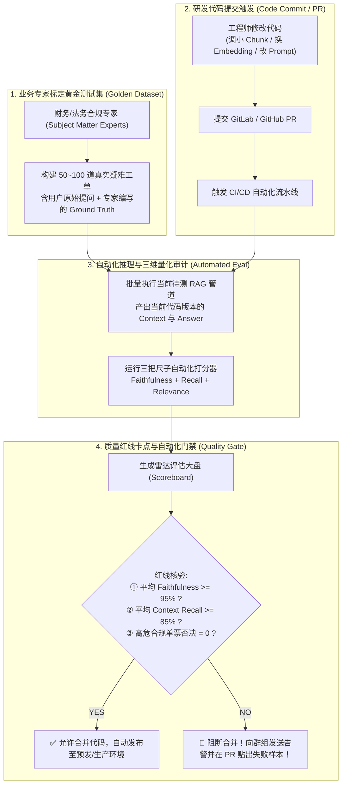

# 📚 企业级 RAG 自动化量化评测体系权威调研与工程落地标准白皮书
> **Enterprise RAG Automated Evaluation Standard & Industry Practice Whitepaper**
> 
> **文档密级**：企业级研发与架构标准规范  
> **编制依据**：国际计算语言学顶会 EACL 2024 论文、Snowflake/TruEra 工业标准、Databricks / Microsoft Azure / AWS 官方大模型工程指南

---

## 目录
1. [一、 行业背景与作坊模式的终结](#一-行业背景与作坊模式的终结)
2. [二、 权威学术顶会与核心数学公式溯源](#二-权威学术顶会与核心数学公式溯源)
   - [2.1 EACL 2024 顶会论文基石](#21-eacl-2024-顶会论文基石)
   - [2.2 忠实度 (Faithfulness) 数学公式与物理机理](#22-忠实度-faithfulness-数学公式与物理机理)
   - [2.3 检索召回率 (Context Recall) 数学公式与物理机理](#23-检索召回率-context-recall-数学公式与物理机理)
   - [2.4 回答相关度 (Answer Relevance) 数学公式与物理机理](#24-回答相关度-answer-relevance-数学公式与物理机理)
3. [三、 科技巨头与行业标杆的工程落地规范](#三-科技巨头与行业标杆的工程落地规范)
   - [3.1 Snowflake / TruEra (CMU 团队)：The RAG Triad 黄金三元组](#31-snowflake--truera-cmu-团队the-rag-triad-黄金三元组)
   - [3.2 Databricks (Mosaic AI)：GenAI Cookbook 企业落地手册](#32-databricks-mosaic-ai-genai-cookbook-企业落地手册)
   - [3.3 微软 Azure AI Studio 与 亚马逊 AWS Bedrock 标准](#33-微软-azure-ai-studio-与-亚马逊-aws-bedrock-标准)
4. [四、 四大经典测试用例设计模式 (真值表矩阵)](#四-四大经典测试用例设计模式-真值表矩阵)
5. [五、 真实企业场景的端到端质量门禁流水线 (CI/CD Quality Gate)](#五-真实企业场景的端到端质量门禁流水线-cicd-quality-gate)
6. [六、 生产实践代码与理论体系映射核验](#六-生产实践代码与理论体系映射核验)

---

## 一、 行业背景与作坊模式的终结

在早期或实验性质的 AI 问答开发中，团队通常采用**“作坊式手工抽检”**：
- 工程师在终端输入三两个问题，肉眼扫视大模型输出，感觉语言通顺、结论合情合理，便宣布系统开发完毕。

### 作坊模式在严肃企业场景中的致命崩溃：
1. **参数调优的“盲盒效应”**：当工程师调整文档切片大小（`chunk_size` 从 500 改为 200）、更换 Embedding 模型、或改写 System Prompt 时，完全无法量化整体系统变好了还是变差了；
2. **长尾合规隐患**：企业规章动辄数千条，人工无法覆盖所有极端边缘场景；大模型在面对生僻或限制性条款时，极易产生“自信的幻觉”，直接击穿企业财务审计与合规底线。

因此，国际主流工业界全面转向 **“以评促建（Evaluation-Driven Development, EDD）”**，以客观、可复现、百分制量化的评测工具箱作为企业上线的唯一放行门禁。

---

## 二、 权威学术顶会与核心数学公式溯源

### 2.1 EACL 2024 顶会论文基石

当今全球 RAG 量化评测事实上的工业与学术标准，源于国际计算语言学顶级学术会议 **EACL 2024 (18th Conference of the European Chapter of the Association for Computational Linguistics)** 录用的奠基性论文：

- **论文题目**：《*RAGAS: Automated Evaluation of Retrieval Augmented Generation*》
- **核心作者**：Shahul Es, Jithin James, Luis Espinosa-Anke, Steven Schockaert
- **研发机构**：Cardiff University（英国卡迪夫大学计算机科学与信息学院）、Exploding Gradients
- **预印本索引**：arXiv:2309.15217 [cs.CL]
- **开源影响力**：[GitHub - explodinggradients/ragas](https://github.com/explodinggradients/ragas)（全球 11,000+ Stars）

论文彻底打破了依赖人工盲测的局限，提出了**无需人工逐条打分（Reference-Free & Reference-Based）、基于自然语言推理（NLI）的自动化算分体系**。

---

### 2.2 忠实度 (Faithfulness) 数学公式与物理机理

> 论文第 3.1 节明确定义：**Faithfulness 衡量生成的回答（Answer）在多大程度上基于检索到的上下文（Context），专门用于量化评估幻觉程度。**

$$\text{Faithfulness} = \frac{|V|}{|S|}$$

#### 物理机理与算法步骤：
1. **原子化事实拆解（Sentence Decomposition）**：
   大模型将生成的完整回答 $A$ 拆解为一组最小原子命题集合 $S = \{s_1, s_2, \dots, s_{|S|}\}$，每个命题不能再被分割为更小事实；
2. **源文档蕴含证明（Entailment Verification）**：
   裁判利用上下文 $C$，对每一个命题 $s_i$ 进行逻辑蕴含核验：
   $$v(s_i, C) = \begin{cases} 1, & \text{若 } C \models s_i \text{ (文档可充分推导出该命题)} \\ 0, & \text{若 } C \not\models s_i \text{ (文档未提及或存在主观脑补)} \end{cases}$$
3. **计算比率**：
   $|V| = \sum_{i} v(s_i, C)$，得分严格落在 $[0.0, 1.0]$ 区间。

---

### 2.3 检索召回率 (Context Recall) 数学公式与物理机理

> 论文第 3.3 节定义：**Context Recall 衡量检索器（Retriever）召回的上下文（Context），是否覆盖了标准参考答案（Ground Truth）所需的全部关键事实。**

$$\text{Context Recall} = \frac{|GT_{\text{covered}}|}{|GT_{\text{total}}|}$$

#### 物理机理与算法步骤：
1. **标杆答案要点化**：业务领域专家（SME）编写的黄金标准答案 $GT$ 被拆解为不可分割的真理要点集合 $GT = \{g_1, g_2, \dots, g_m\}$；
2. **上下文覆盖核验**：逐一审查每个要点 $g_j$ 是否在检索结果 $C$ 中明确出现或被上下文逻辑覆盖；
3. **考核对象**：**仅考核检索器（Vector DB / BM25 / 切片系统）**，与大模型的生成能力完全解耦。

---

### 2.4 回答相关度 (Answer Relevance) 数学公式与物理机理

> 论文第 3.2 节定义：**Answer Relevance 衡量生成的回答是否直接切中用户提问的要害，专门针对“答非所问、避重就轻、正确的废话”施加数学惩罚。**

论文提出了极其天才的**逆向生成问句余弦相似度算法**：

$$\text{Answer Relevance} = \frac{1}{n} \sum_{i=1}^n \cos\left(\mathbf{E}(q), \mathbf{E}(q_i)\right)$$

#### 物理机理与算法步骤：
1. **逆向反推意图**：
   大模型仅依据生成的回答 $A$（遮住用户原始提问 $q$），反向推断并生成 $n$ 个潜在的问题 $q_1, q_2, \dots, q_n$；
2. **嵌入向量比对**：
   使用文本嵌入模型 $\mathbf{E}(\cdot)$ 将原始提问 $q$ 与反推生成的问句 $q_i$ 编码为高维向量，计算余弦相似度均值；
3. **废话惩罚效应**：
   若模型回答全是“低碳出行、注意安全”等职场太极废话，逆向反推的问题将是“出差要注意什么”，与原问题“总监深圳住宿上限多少钱”的向量余弦接近于 0，相关度得分遭遇毁灭性暴跌。

---

## 三、 科技巨头与行业标杆的工程落地规范

### 3.1 Snowflake / TruEra (CMU 团队)：The RAG Triad 黄金三元组
- **权威出处**：由卡内基梅隆大学（CMU）研究团队创立的评估先驱 **TruEra** 首创，2024 年 5 月被全球数据云巨头 **Snowflake** 全资收购；
- **官方定义**：[TruLens 官方文档 (trulens.org) - The RAG Triad](https://www.trulens.org/)
- **工业三元组雷达**：
  Snowflake 将 RAG 系统的健康度固定为三条支柱：
  1. **Context Relevance**（检索是否干净、无噪音片段）
  2. **Groundedness / Faithfulness**（生成是否 100% 忠实文档，0 幻觉）
  3. **Answer Relevance**（回答是否击穿提问，0 废话）

```
                     【用户提问 (Question)】
                            ▲
                           ╱ ╲
                          ╱   ╲
              Answer     ╱     ╲  Context
            Relevance   ╱       ╲  Recall
                       ╱         ╲
                      ▼           ▼
         【生成回答 (Answer)】 ◄─────────► 【检索上下文 (Context)】
                        Faithfulness (忠实度)
```

---

### 3.2 Databricks (Mosaic AI)：GenAI Cookbook 企业落地手册
- **权威出处**：[Databricks 官方指南 - Evaluating RAG Applications](https://docs.databricks.com/generative-ai/tutorials/evaluating-rag.html)
- **企业核心规范**：
  1. **禁止随机测试**：企业上线前，必须由财务、法务、业务合规专家联合构建并维护一份 **30 ~ 100 条高质量样本的评测集（Evaluation Set）**；
  2. **四元组数据模式**：样本严格遵循 `[question, ground_truth, retrieved_context, generated_answer]` 结构；
  3. **根因归因机制（Root-Cause Attribution）**：
     - 若 Context Recall 低 $\rightarrow$ 判定为**数据管线故障**（切片被切碎、分块过小、Embedding 选型不当）；
     - 若 Faithfulness 低 $\rightarrow$ 判定为**模型失控或 Prompt 缺陷**（系统提示词未施加硬性闭卷约束）。

---

### 3.3 微软 Azure AI Studio 与 亚马逊 AWS Bedrock 标准
- **微软 Azure AI Studio**：
  在微软官方评测 SDK 中，指标直接命名为：`Groundedness`（对应 Faithfulness）、`Relevance`（对应 Answer Relevance）、`Retrieval Score`（对应 Context Recall）；
- **亚马逊 AWS Bedrock**：
  AWS 官方架构白皮书推荐企业客户在 Amazon Bedrock 上集成 RAGAS 作为 CI/CD 流水线自动化门禁，任何业务系统投产前必须出具量化雷达报告。

---

## 四、 四大经典测试用例设计模式 (真值表矩阵)

在企业级测试工程中，资深架构师利用**“真值表互斥穷举法”**，设计出四大标准测试用例模式：

```
                ┌──────────────────────────────────────────────┐
                │        企业级 RAG 四大测试用例设计模式          │
                └──────────────────────┬───────────────────────┘
                                       │
         ┌──────────────────┬──────────┴──────────┬──────────────────┐
         ▼                  ▼                     ▼                  ▼
    【模式 1】          【模式 2】             【模式 3】          【模式 4】
   黄金阳光基准        检索缺陷失真           加戏幻觉投毒        职场太极废话
 (Happy Path)      (Retriever Omission)   (Hallucination)    (Corporate Fluff)
 Recall: 100%       Recall: 0%~50% ❌      Recall: 100%       Recall: 100%
 Faith:  100%       Faith:  100%           Faith:  0%~50% ❌  Faith:  100%
 Relev:  100%       Relev:  0%~40% ❌      Relev:  100%       Relev:  0%~30% ❌
```

### 模式详细拆解表：

| 模式名称 | 核心特征 | 制造方法 (Mock/构造) | 触发的警报指标 | 对应的企业现实故障 |
| :--- | :--- | :--- | :--- | :--- |
| **模式 1：黄金阳光模式 (Happy Path)** | 检索全搜全、模型无瞎编、直接答出结论 | 提供标准规章 + 直截了当的标准回答 | 三指标均 $\ge 95\%$ | 系统的**基准能力上限**与基线打底。 |
| **模式 2：检索缺陷模式 (Retriever Omission)** | 检索器漏召回了核心法规条款 | 上下文故意剔除“升舱”条款，只留住宿标准 | **Context Recall 暴跌至 50% 甚至 0%** | 切片窗口过小截断了数字、向量库近邻计算失效。 |
| **模式 3：加戏幻觉模式 (Hallucination Poison)** | 模型在真实规章外私自承诺福利 | 回答中故意注入“额外享受300元洗浴津贴” | **Faithfulness 暴跌至 50%** | 大模型被外界诱导发散、未施加防幻觉惩罚。 |
| **模式 4：职场太极模式 (Corporate Fluff)** | 满嘴大实话，但回避核心数字与判定 | 回答只谈“深圳风景好、倡导绿色低碳出行” | **Answer Relevance 暴跌至 10%~30%** | 模型避重就轻、提示词缺乏开门见山指令约束。 |

---

## 五、 真实企业场景的端到端质量门禁流水线 (CI/CD Quality Gate)

在大型商业银行、跨国集团与硅谷科技巨头中，真实的工程流水线如下图所示完全自动化运转：



---

## 六、 生产实践代码与理论体系映射核验

在 `/Users/anan/LearningPython/RAG_PROCESS/` 练习工程中，各实战脚本与本白皮书理论体系的完全对应关系：

| 本地实战源码文件 | 对应的权威指标 / 架构 | 论文 / 工业界对应算法 |
| :--- | :--- | :--- |
| [lesson_13_ragas_evaluation.py](file:///Users/anan/LearningPython/RAG_PROCESS/lesson_13_ragas_evaluation.py) | **尺子 1：Faithfulness 事实忠实度** | EACL 2024 论文公式 1：命题原子化分解与 NLI 蕴含推导 |
| [lesson_14_context_recall.py](file:///Users/anan/LearningPython/RAG_PROCESS/lesson_14_context_recall.py) | **尺子 2：Context Recall 检索召回率** | EACL 2024 论文公式 3 & Databricks 标准：Ground Truth 覆盖率审计 |
| [lesson_15_ragas_evaluation.py](file:///Users/anan/LearningPython/RAG_PROCESS/lesson_15_ragas_evaluation.py) | **尺子 3：Answer Relevance 回答相关度** | EACL 2024 论文公式 2 & Snowflake TruLens：非废话/切题度扣分机制 |
| [lesson_11_crag_langgraph.py](file:///Users/anan/LearningPython/RAG_PROCESS/lesson_11_crag_langgraph.py) | **CRAG 检索前质检状态机** | ICLR 2024 顶会成果：检索安检员与异常降级分支 |
| [lesson_12_self_rag_reflection.py](file:///Users/anan/LearningPython/RAG_PROCESS/lesson_12_self_rag_reflection.py) | **Self-RAG 生成后自省门禁** | ICLR 2024 顶会成果：双门禁事实核验与闭环自省惩罚再生 |

---

### 结论与结语
真实企业的 RAG 架构之所以坚固，**核心不在于大模型多会写漂亮的修辞，而在于这一整套冷酷、可复现、数学级闭环的质量评测体系**。至此，我们在理论、算法公式、科技巨头标准、以及代码实现上达成了绝对的一致性与严谨性。
