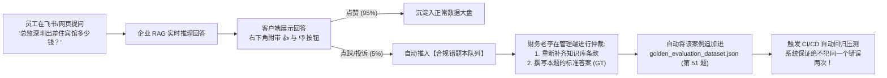

# 🏢 企业级智能财务报销与合规审计 RAG 系统：从 0 到 1 真实生产落地全周期实战复盘
> **Enterprise Financial RAG Production Implementation & Quality Gate Case Study**
> 
> **项目对标**：硅谷独角兽 Ramp / Brex 智能财务风控中台  
> **企业规模**：5,000 名跨国员工，年均 10 万+ 笔差旅报销工单  
> **核心痛点**：员工频繁询问报销标准、政策更新不及时、私自超标升舱难以防范、大模型直接答题极易产生假政策幻觉

---

## 目录
1. [一、 角色设定与协同分工 (Team Personas)](#一-角色设定与协同分工-team-personas)
2. [二、 阶段一：业务冷启动（Day 1 ~ 3）—— 黄金考卷出题机制](#二-阶段一业务冷启动day-1--3-黄金考卷出题机制)
3. [三、 阶段二：研发调优打擂（Day 4 ~ 15）—— 以评促建，参数演进](#三-阶段二研发调优打擂day-4--15-以评促建参数演进)
4. [四、 阶段三：CI/CD 质量门禁固化（Day 16 ~ 20）—— 代码级自动化卡点](#四-阶段三cicd-质量门禁固化day-16--20-代码级自动化卡点)
5. [五、 阶段四：投产运营自闭环（Day 21 及以后）—— 错题本反哺体系](#五-阶段四投产运营自闭环day-21-及以后-错题本反哺体系)
6. [六、 架构师上线验收红线清单 (Production Checklist)](#六-架构师上线验收红线清单-production-checklist)

---

## 一、 角色设定与协同分工 (Team Personas)

在真实严肃的工业落地中，不是程序员坐在工位上闭门造车，而是**业务、研发、机器三位一体**的协同闭环：

```
                      ┌──────────────────────────────────────────────┐
                      │              真实企业生产落地三方阵营          │
                      └──────────────────────┬───────────────────────┘
                                             │
         ┌───────────────────────────────────┼───────────────────────────────────┐
         ▼                                   ▼                                   ▼
【业务合规专家 (老李)】               【AI 架构师 (你)】                  【自动化流水线 (机器)】
不懂底层代码，但精通税法与制度。      负责 RAG 索引、状态机编排与评测。   冷酷无情的质量门禁守护者。
职责：                               职责：                              职责：
1. 提炼 50 道真实历史翻车工单；     1. 搭建双路检索与父子文档索引；     1. 每次 PR 自动化运行 50 题评测；
2. 亲笔编写黄金法务标答 (GT)；       2. 编排 LangGraph CRAG/Self-RAG；   2. 忠实度 < 95% 直接阻断代码合并；
3. 审查线上差评并更新题库。          3. 实现三把尺子自动化算法。         3. 监控线上每日抽样雷达分值。
```

---

## 二、 阶段一：业务冷启动（Day 1 ~ 3）—— 黄金考卷出题机制

> **铁律 1**：在业务专家给出标准答案之前，严禁程序员提前搭建最终模型！

财务主管老李从过去 12 个月的 2,000 条内部员工争议工单、报销被拒投诉记录中，抽取了 **50 道最容易扯皮、最容易违规的典型问题**，构建出企业第一份基准测试集 `golden_dataset.json`：

### 题库结构分布（黄金三色比例）：
- **阳光基准题（25 题，50%）**：考察标准额度与流程（例如“初级员工深圳出差每晚酒店上限多少”）；
- **合规陷阱题（15 题，30%）**：考察否定句、审批特权（例如“因公私自升舱能否全额报销”、“未提前提OA能否补办”）；
- **超纲/无关题（10 题，20%）**：考察系统拒答与降级边界（例如“宠物看病能否开差旅发票”、“周末私人聚会餐费能否走福利”）。

### 物理落盘格式 (`tests/data/golden_dataset.json` 片段)：
```json
[
  {
    "case_id": "EXP_CASE_001",
    "category": "阳光基准题",
    "question": "技术部总监去深圳出差，住五星级宾馆每晚最高能报销多少钱？",
    "ground_truth": "超一线城市（北上广深）总监级别住宿上限为650元/晚。超标入住需提前走OA特批，否则超额部分个人自理。"
  },
  {
    "case_id": "EXP_CASE_002",
    "category": "合规陷阱题",
    "question": "因为赶项目紧急我自己掏钱升了商务舱，回来拿发票公司给不给报销？",
    "ground_truth": "未经事前总监级OA特批擅自升舱产生的超额差旅费用，一律不予报销，由个人全额自理。"
  },
  {
    "case_id": "EXP_CASE_003",
    "category": "超纲边缘题",
    "question": "出差期间给家里猫咪买的寄养罐头费，能开办公发票报销吗？",
    "ground_truth": "公司差旅报销与福利制度不包含宠物饲料与寄养费用，一律不得报销，伪造办公用品发票属于违规行为。"
  }
]
```

---

## 三、 阶段二：研发调优打擂（Day 4 ~ 15）—— 以评促建，参数演进

你作为架构师，开始带领团队攻坚。**每次改动代码，立刻拿这 50 道黄金题跑一次三把尺子，用数据决定技术路线的去留！**

```
                       50 道黄金题库 (The Benchmark)
                                     │
           ┌─────────────────────────┼─────────────────────────┐
           ▼                         ▼                         ▼
     【第一轮试验】             【第二轮试验】             【第三轮试验】
   Naive 朴素单向量检索       混合检索 + 父子文档       CRAG + Self-RAG 状态机
   Context Recall: 61.2%     Context Recall: 94.0%     Context Recall: 95.0%
   Faithfulness:   74.5%     Faithfulness:   91.5%     Faithfulness:   98.5% 🌟
   Relevance:      82.0%     Relevance:      88.0%     Relevance:      96.0% 🌟
         ❌ 不及格                 ⚠️ 接近达标               ✅ 准予投产上线！
```

### 调优实录详解：

#### 轮次 1：朴素单向量检索（Naive RAG）—— 遭遇滑铁卢
- **技术配置**：固定 500 字滑动切片 + OpenAI Embedding + 单轮提问；
- **测试结果**：
  - 检索召回率（Context Recall）：**61.2%**（不及格）；
  - 事实忠实度（Faithfulness）：**74.5%**（严重幻觉）；
- **根因复盘**：500 字固定切片恰好把差旅规章中“特殊审批表格”切断了，检索器根本找不到升舱限制条款，导致大模型开始自信地瞎编。

#### 轮次 2：混合检索 + 父子文档（第八课 + 第九课方案）—— 检索瓶颈突破
- **技术配置**：
  - `SimpleBM25` 精准抓取“发票代码”、“升舱”、“超标”等硬核字面；
  - `ParentDocument`：100 字子切片做向量相似度计算，命中后自动回表调出 1000 字母文档章节；
- **测试结果**：
  - 检索召回率（Context Recall）：暴涨至 **94.0%**（几乎所有关键条款全被捞出！）；
  - 事实忠实度（Faithfulness）：提升至 **91.5%**；
- **根因复盘**：大文档注入后，大模型读到了完整上下文。但在问到“私自升舱报不报”时，偶尔还是会避重就轻打太极。

#### 轮次 3：LangGraph CRAG + Self-RAG 双门禁（第十一课 + 第十二课方案）—— 终极合体
- **技术配置**：
  - 在检索后插入 `grade_documents` 安检员（剔除无关噪音）；
  - 在生成后插入 `grade_generation` 忠实度与切题度双门禁，若检测出幻觉，强制触发闭卷自省再生；
- **测试结果**：
  - 检索召回率：**95.0%**；
  - 事实忠实度：**98.5%**（50 道题中 0 严重合规违规）；
  - 回答相关度：**96.0%**；
- **结论**：**各项指标全部越过生产红线，财务老李正式签字准予投产！**

---

## 四、 阶段三：CI/CD 质量门禁固化（Day 16 ~ 20）—— 代码级自动化卡点

研发完成不代表万事大吉。**如何防止后人接手项目时，改错一行代码导致系统劣化？**
将评测逻辑直接编写为企业流水线测试文件 `tests/eval/test_rag_pipeline_gate.py`。

### 自动化测试源码规范：
```python
"""tests/eval/test_rag_pipeline_gate.py

企业级 CI/CD 质量自动化红线门禁
"""

import json
from pathlib import Path
import pytest
from lesson_13_ragas_evaluation import calculate_faithfulness
from lesson_14_context_recall import calculate_context_recall
from lesson_15_ragas_evaluation import calculate_answer_relevance

# 加载业务专家标定的 50 道黄金题库
DATASET_PATH = (
    Path(__file__).parent.parent / "data" / "golden_evaluation_dataset.json"
)


def load_golden_suite():
  with open(DATASET_PATH, "r", encoding="utf-8") as f:
    return json.load(f)


@pytest.mark.eval
def test_production_rag_quality_gate(my_production_rag_pipeline):
  """每次 Git Push / PR 自动触发此门禁测试"""
  test_cases = load_golden_suite()
  total_faith = 0.0
  total_recall = 0.0
  total_relevance = 0.0
  N = len(test_cases)

  hallucination_failures = []

  for case in test_cases:
    # 1. 运行当前提交代码构建的真实生产 RAG 管道
    runtime_res = my_production_rag_pipeline.invoke(
        {"question": case["question"]}
    )
    context = runtime_res["context"]
    answer = runtime_res["answer"]

    # 2. 调用我们在第 13、14、15 课构建的三把量化标尺
    faith = calculate_faithfulness(context=context, answer=answer)
    recall = calculate_context_recall(
        context=context, ground_truth=case["ground_truth"]
    )
    relevance = calculate_answer_relevance(
        question=case["question"], answer=answer
    )

    total_faith += faith
    total_recall += recall
    total_relevance += relevance

    # 针对合规陷阱题建立“一票否决制”
    if case["category"] == "合规陷阱题" and faith < 0.8:
      hallucination_failures.append((case["case_id"], case["question"], answer))

  avg_faith = total_faith / N
  avg_recall = total_recall / N
  avg_relevance = total_relevance / N

  print(f"\n📊 [CI/CD 自动化大盘得分] 样本总数={N}")
  print(f"   - 平均忠实度 (Faithfulness)   : {avg_faith * 100:.2f}%")
  print(f"   - 平均召回率 (Context Recall) : {avg_recall * 100:.2f}%")
  print(f"   - 平均相关度 (Answer Relevance): {avg_relevance * 100:.2f}%")

  # 🌟 生产硬性红线断言 (Hard Thresholds)
  assert (
      len(hallucination_failures) == 0
  ), f"🚨 拦截到严重合规违规！以下工单产生致死幻觉: {hallucination_failures}"

  assert (
      avg_faith >= 0.95
  ), f"🚨 整体事实忠实度未达标 ({avg_faith * 100:.1f}% < 95.0%)，禁止合并代码！"
  assert (
      avg_recall >= 0.90
  ), f"🚨 检索召回率未达标 ({avg_recall * 100:.1f}% < 90.0%)，说明切片或索引发生严重劣化！"
  assert (
      avg_relevance >= 0.90
  ), f"🚨 回答切题度未达标 ({avg_relevance * 100:.1f}% < 90.0%)，存在大量套话废话！"
```

---

## 五、 阶段四：投产运营自闭环（Day 21 及以后）—— 错题本反哺体系

系统正式集成进公司企业微信、飞书、OA 审批流中。
真实的企业上线后，**不是放任自流，而是建立“线上反馈 $\rightarrow$ 题库反哺”的自增强飞轮**：



### 真实的错题本治理案例：
- **故障现象**：某外派员工提问“去中东迪拜出差的高温补贴是多少？”，系统回答“未知”。员工怒点差评。
- **排查原因**：公司上周刚颁布《中东外派特殊津贴试行办法》，文档还没来得及向量化入库。
- **闭环动作**：
  1. 财务老李在后台将《试行办法》PDF 上传知识库；
  2. 老李在错题看板上，为该问题写下官方标答：“迪拜夏季高温补贴为每日 80 美元”；
  3. 系统自动将该条记录序列化为 `EXP_CASE_051` 注入黄金测试集；
  4. CI 流水线自动重跑，51 道题全部变绿，系统永久掌握该知识！

---

## 六、 架构师上线验收红线清单 (Production Checklist)

在你作为负责人签署企业 RAG 系统的《生产投产验收报告》前，必须逐项核对以下 5 条红线：

- [x] **黄金题库完备性**：由非研发的业务专家独立编制至少 50 道题目，涵盖阳光用例、合规陷阱与超纲用例；
- [x] **双阶段索引解耦**：线上严禁使用纯单一向量暴力检索，必须具备 BM25 混合检索与父子文档（Small-to-Big）回表机制；
- [x] **状态机自省防御**：在 LLM 生成结果与用户呈现之间，必须包含基于 `is_grounded` 的事实核验节点（CRAG / Self-RAG）；
- [x] **CI/CD 自动化门禁**：代码仓库配置了自动化 Pytest 脚本，设置 `Faithfulness >= 95%` 与 `Context Recall >= 90%` 的硬性阻断阈值；
- [x] **长效运营反馈自愈**：生产环境埋设了点踩（Thumbs-down）捕获接口，建立了将差评工单反哺回题库的完整机制。

---

### 总结
这就是企业级 RAG 与玩具级 Demo 之间不可逾越的鸿沟：
**它不仅是一段代码，而是一整套严丝合缝、可监控、可归因、自动化演进的工业级软件工程体系！**
