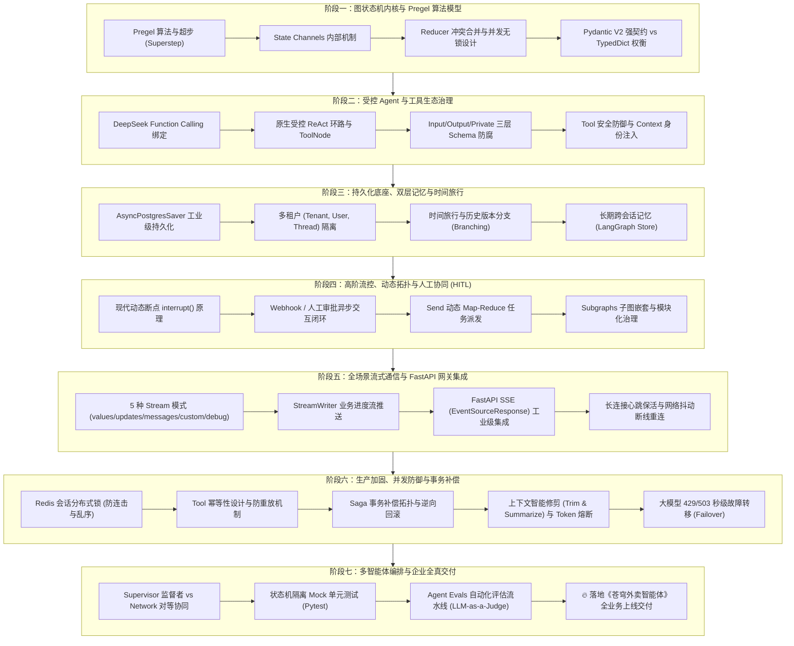

# 🚀 企业级 LangGraph 架构师实战体系与进阶全景指南

> **适用定位**：具备成熟后端工程素养（Java / 企业级 Python、关系型数据库、中间件、分层架构），以真实交付企业级高可用、高可靠自主 AI Agent 系统为目标的架构师与研发工程师。  
> **核心原则**：严禁玩具级脚本（No Toy Code），摒弃单文件 Demo，对标工业界生产就绪标准（Pregel 状态机内核、多租户行级隔离、会话互斥分布式锁、Saga 事务补偿、五维流式网关、Pytest 自动化评估门禁）。  
> **基座技术栈**：`Python 3.12+` | `LangGraph 1.2+` | `DeepSeek-V3 / R1` | `Pydantic V2` | `FastAPI SSE` | `AsyncPostgreSQL` | `Redis`

---

## 目录
- [一、 玩具级 Demo vs 企业生产级架构对比](#一-玩具级-demo-vs-企业生产级架构对比)
- [二、 架构演进全景路线图](#二-架构演进全景路线图)
- [三、 模块与学时详细规划](#三-模块与学时详细规划)
  - [阶段一：图状态机内核与 Pregel 算法模型](#阶段一图状态机内核与-pregel-算法模型约-4-课时)
  - [阶段二：受控 Agent 架构与工具生态治理](#阶段二受控-agent-架构与工具生态治理约-5-课时)
  - [阶段三：持久化底座、双层记忆与时间旅行](#阶段三持久化底座双层记忆与时间旅行约-6-课时)
  - [阶段四：现代高阶流控、动态任务派发与人工审批](#阶段四现代高阶流控动态任务派发与人工审批约-5-课时)
  - [阶段五：全场景流式通信与 FastAPI 生产网关集成](#阶段五全场景流式通信与-fastapi-生产网关集成约-5-课时)
  - [阶段六：企业级生产加固、并发防御与事务补偿](#阶段六企业级生产加固并发防御与事务补偿约-5-课时)
  - [阶段七：多智能体编排 (Multi-Agent) 与企业全真交付](#阶段七多智能体编排-multi-agent-与企业全真交付约-7-课时)
- [四、 学习节奏与进度打卡表](#四-学习节奏与进度打卡表)
- [五、 基础工程规范与环境说明](#五-基础工程规范与环境说明)

---

## 一、 玩具级 Demo vs 企业生产级架构对比

| 核心维度 | 常见视频/教程做法（Toy Code） | 企业生产级实战标准（Production-Grade） |
| :--- | :--- | :--- |
| **工程架构** | 单个 `.py` 或 `.ipynb` 文件，代码、Prompt、DB 连接混成一团。 | **Clean Architecture 分层架构**：领域层（State/Nodes）、基础设施层（Saver/DB）、接口适配层（FastAPI Controller），严格解耦。 |
| **运行时生命周期** | 在每个 HTTP 请求里调用 `workflow.compile()`。<br>*(致命缺陷：高并发下 CPU 暴涨、内存瞬间泄露)* | **FastAPI Lifespan 单例编译**：图在应用启动时仅编译一次常驻内存，请求到来时仅传入上下文句柄与 `thread_id`，纯无状态并发调用。 |
| **存储与持久化** | 使用 `MemorySaver()`（存放在本地内存，进程重启数据全丢）。 | **`AsyncPostgresSaver` + 连接池治理**：异步 I/O，支持读写分离、分区索引、会话 TTL 自动归档，无惧 Pod 重启漂移。 |
| **多租户与数据安全** | 全局直接使用 `thread_id="123"`。<br>*(致命缺陷：可能发生越权，数据串号)* | **三元组多租户隔离**：`checkpoint_ns` 绑定 `(tenant_id, org_id, user_id)`，从底层存储硬隔离，绝不发生跨企业数据串号。 |
| **Tool 安全与越权防御** | 大模型生成 `{user_id: 10, order_id: 88}`，Tool 节点盲目根据这个参数查数据库。 | **零信任（Zero-Trust）安全防腐**：Tool 的参数只负责业务要素，用户身份从 JWT / Request Context 强制注入，模型绝对无法越权篡改 `user_id`。 |
| **并发与状态一致性** | 裸奔调用。用户连击两下“发送”，产生两条并行图，并发写入同一个 Checkpoint 导致状态混乱。 | **Redis 异步分布式防抖锁**：基于 `thread_id` 加锁与请求排队机制，保证同一会话的消息串行化，彻底杜绝状态脏写。 |
| **事务与可靠性** | 执行“扣优惠券 -> 扣余额 -> 调厨房”；一旦中间报错直接中断，造成资金半拉子脏数据。 | **Saga 分布式事务补偿拓扑**：设计正向流水线与逆向补偿分支（Compensating Action），失败时自动触发状态逆向回滚与告警。 |
| **流式交互与网关** | 在控制台终端里 `for event in graph.stream(): print(...)`。 | **FastAPI SSE 标准事件流**：打通浏览器/移动端标准 `EventSourceResponse`，分流输出 Token 碎片、自定义步骤进度与业务数据。 |
| **模型高可用与兜底** | 遇到 DeepSeek / 外部模型 429 限流或 503 宕机，整个接口直接向前端抛 500 异常。 | **主备无感故障转移（Failover）**：配置 `ChatOpenAI.with_fallbacks()`，遇到限流或超时在毫秒内静默熔断至备用模型。 |
| **测试与 CI/CD** | 每次测试都人工发一条 Prompt 看大模型回什么，甚至不写自动化测试。 | **状态机 Mock 单元测试 (Pytest)**：脱离昂贵且不稳定的真实模型网络调用，用 Mock 节点 2 秒内跑完 100% 的图路径与边界单测。 |
| **可观测性 (APM)** | 靠控制台 `print` 找 Bug。 | **生产级全链路追踪**：无缝接入 **Langfuse / LangSmith**，每一个 Token 消耗、每个节点的耗时瀑布流、输入输出全量审计落盘。 |

---

## 二、 架构演进全景路线图



---

## 三、 模块与学时详细规划

### 阶段一：图状态机内核与 Pregel 算法模型（约 4 课时）
> **目标**：彻底理解 LangGraph 与传统链式框架的本质区别，掌握超步边界与状态合并机制。

* **1.1 从 LCEL 迈向图状态机**
  * 有向无环图 (DAG) 与循环图 (DCG) 差异。
  * 状态机数学定义：$S_{t+1} = f(S_t, I)$。
  * 手写第一个带条件循环的基础状态机拓扑：`START -> NodeA -> NodeB -> (循环/终止) -> END`。
* **1.2 Google Pregel 算法与超步 (Superstep)**
  * 批量同步并行 (BSP) 模型深度拆解。
  * 节点的并发执行与同步屏障 (Synchronization Barrier)。
  * 编写具有 3 个并行分支汇聚到一个收敛节点的拓扑图，观察超步生命周期。
* **1.3 State Channel 内部机制与 Reducer 冲突治理**
  * `LastValue` 覆写通道 vs 聚合通道。
  * `Annotated[list, operator.add]` 原理。
  * 自定义复杂字典深度合并（Deep Merge）Reducer，解决并发写入抛出 `InvalidUpdateError`。
* **1.4 Pydantic V2 强模式 vs TypedDict 权衡**
  * 运行时类型强校验、默认值与别名注入。
  * 用 Pydantic V2 构建带校验规则的领域状态（OrderState），拦截非法状态流转。

---

### 阶段二：受控 Agent 架构与工具生态治理（约 5 课时）
> **目标**：掌控大模型与外部系统交互的控制流，实现高鲁棒性的自主工具循环。

* **2.1 DeepSeek Function Calling 深度绑定**
  * 基于 OpenAI 兼容规范配置 `bind_tools`。
  * `@tool` 描述元数据设计与 Prompt 协同优化。
* **2.2 原生受控 ReAct 环路与 ToolNode 源码拆解**
  * 拆解 `ToolNode` 与 `tools_condition` 条件边底层逻辑。
  * 手写纯原生受控 ReAct 智能体，不依赖 Prebuilt 黑盒，洞察消息驱动的底层流转。
  * 当模型反复以相同参数调用同一个 Tool 时的死循环拦截策略。
* **2.3 输入/输出 Schema 防腐层架构设计**
  * `InputState`（对外请求契约）与 `OutputState`（对外响应契约）。
  * `PrivateState`（内部私有工作记忆，计算完毕后自动销毁，避免污染上下文）。
* **2.4 Tool 调用的安全防御与身份上下文注入**
  * 防 IDOR 越权攻击实战。
  * 从 Runtime Context 强制注入当前登录用户的 `user_id` / `tenant_id`，模型仅负责提取业务参数。

---

### 阶段三：持久化底座、双层记忆与时间旅行（约 6 课时）
> **目标**：告别内存级玩具，实现分布式状态快照、跨会话长期记忆与任意历史状态分支派生。

* **3.1 持久化引擎与 Checkpointer 内部数据模型**
  * 深入剖析 `checkpoint_id`, `checkpoint_ns`, `parent_checkpoint_id`。
  * 接入 `AsyncPostgresSaver`，实现服务重启后对话状态的无损恢复与异步连接池治理。
* **3.2 Thread ID 会话隔离与多租户分表设计**
  * 基于 `(tenant_id, user_id, session_id)` 构建企业级多租户状态隔离策略。
* **3.3 时间旅行（Time Travel）与版本树分支派生**
  * 读取任意历史快照，修改大模型的思考参数。
  * 从历史中间步骤“分叉”（Forking）出一条全新流转轨迹，支持人工干预与假设推演。
* **3.4 短期工作记忆 vs 长期跨会话记忆（LangGraph Store）**
  * 短期记忆（Checkpoint）的生命周期局限。
  * 基于 `AsyncPostgresStore` 搭建用户偏好画像存储，实现跨会话的记忆持久召回。

---

### 阶段四：现代高阶流控、动态任务派发与人工审批（约 5 课时）
> **目标**：掌握 LangGraph 现代核心特性，驾驭动态拓扑与真实的人工协同业务闭环。

* **4.1 现代动态断点 `interrupt()` 深度剖析**
  * 告别旧版 `interrupt_before`。
  * 模拟外卖“大额退款”场景：遇到风控节点自动触发 `interrupt` 中断挂起。
* **4.2 人工审批异步交互闭环（Approve / Edit / Reject）**
  * 编写模拟 Webhook / 外部审批接口：运营人员批准或修改金额后，通过 Command (`resume`) 恢复图执行。
* **4.3 动态 Map-Reduce 任务派发（`Send` API）**
  * 解决静态边无法处理未知数量任务的痛点。
  * 动态派生 N 个并行子分支处理数据，最终聚合汇总。
* **4.4 子图架构（Subgraphs）与模块化治理**
  * 独立状态子图设计。
  * 将复杂的“退款风控核验”封装为自包含子图，嵌套进主业务图中。

---

### 阶段五：全场景流式通信与 FastAPI 生产网关集成（约 5 课时）
> **目标**：打通前后端实时交互链路，实现大模型输出与业务进度的毫秒级流式响应。

* **5.1 LangGraph 五大流式模式终极对比**
  * `values`（全量快照流）、`updates`（节点增量流）、`messages`（Token 打字机流）、`custom`（业务进度流）、`debug`（调试流）。
  * 准确区分思考内容（Reasoning）、普通回复（Content）与工具碎片（ToolCalls）。
* **5.2 自定义业务进度推送（`StreamWriter` 实践）**
  * 节点内主动向前端推送步骤进度（如：“正在锁定库存...正在校验优惠券...”）。
* **5.3 FastAPI SSE (Server-Sent Events) 工业级集成**
  * 单例 Graph 编译与 FastAPI Lifespan 绑定。
  * 封装标准 `EventSourceResponse`，输出复合流（进度步骤 + Token 流 + 业务数据）。
* **5.4 长连接心跳保活与网络抖动断线重连**
  * 保持连接活跃，避免 Nginx / 网关超时斩断连接；支持断线后基于游标恢复流式响应。

---

### 阶段六：企业级生产加固、并发防御与事务补偿（约 5 课时）
> **目标**：掌握高可用系统的防御性工程手段，保证高并发下的系统稳定与数据一致性。

* **6.1 会话并发互斥锁（Redis Concurrency Lock）**
  * 基于 `thread_id` 编写 Redis 异步分布式互斥锁，彻底杜绝用户连击导致的状态脏写与消息乱序。
* **6.2 Tool 幂等性设计与防重放机制**
  * 编写带有业务幂等键校验的写操作 Tool，保证重试时不发生重复扣款或重复下单。
* **6.3 Saga 事务补偿拓扑与逆向回滚**
  * 设计正向执行流水线与反向补偿分支（Compensating Action），中途失败时自动回滚历史操作。
* **6.4 上下文智能修剪（Trim & Summarize）与 Token 熔断**
  * 动态上下文裁剪中间件：长对话自动触发异步精炼摘要，配置单会话 Token 预算超标硬熔断。
* **6.5 大模型 429/503 秒级故障转移（Failover）**
  * 配置 `with_fallbacks`：当 DeepSeek 限流或超时，毫秒级无感切至备用提供商。

---

### 阶段七：多智能体编排 (Multi-Agent) 与企业全真交付（约 7 课时）
> **目标**：融会贯通，直接赋能真实业务，完成从零到一的 Agent 编排机制、隔离单测与评估门禁。

* **7.1 多智能体架构对比与选型**
  * 监督者模式（Supervisor） vs 扁平对等网络（Network / Handoffs）实现与权衡。
* **7.2 状态机隔离 Mock 单元测试 (Pytest)**
  * 脱离真实大模型的高速 Mock 单测：2 秒内跑完复杂状态图的所有条件分支与异常路径。
* **7.3 企业级 Agent 评估门禁（Evals & LLM-as-a-Judge）**
  * 构建黄金基准评测集（Golden Dataset），量化评估工具调用召回率与忠实度。
* **7.4 苍穹外卖智能体原型验证（Sky Takeout Agent Core Logic）**
  * 在状态机内部跑通点餐、物流追踪、大额退款动态审批 `interrupt()` 与 Supervisor 终态守卫的核心逻辑闭环。

---

### 阶段八：工业级全栈工程重构与生产交付（The Real-World Enterprise Production System）（约 6 课时）
> **目标**：彻底告别单文件 Demo 与内存模拟，依托 `sky_takeout_agent` 真实微服务架构，打通真实数据库表、真实分布式中间件、Clean Architecture 分层与 Docker 容器化编排。

* **8.1 领域模型设计与数据库持久化（Domain Models & Alembic DDL）**
  * 彻底废弃内存字典，设计 MySQL 真实业务表：菜品库存表 (`dish`)、订单表 (`orders`)、退款幂等流水表 (`refund_ledger`)。
  * 编写 Alembic 版本化迁移脚本执行 DDL 变更，保障表结构审计与回滚能力。
  * 封装 SQLAlchemy 异步仓储层 (`DishRepository`, `RefundRepository`)，实装行级排他锁与事务 ACID 保障。
* **8.2 分布式基础设施实装（Redis Distributed Lock & Postgres Checkpointer）**
  * 接入真实 Redis 分布式互斥锁，基于 `thread_id` 实现多 Pod 集群级并发防抖与租约自动续期（Lease Renewal）。
  * 替换 `MemorySaver`，实装生产级持久化快照引擎（PostgresSaver / DB-backed Checkpointer），实现断点与记忆跨实例共享、宕机不丢。
* **8.3 智能体分层解耦与依赖注入（Clean Architecture / DDD 分层装配）**
  * 将单文件代码彻底解耦拆分到 `sky_takeout_agent/src/app` 工业级目录：
    * `core/`: 基础设施与配置校验
    * `schemas/`: 请求、响应与 Agent State 强类型 DTO
    * `services/agent/tools/`: 依赖注入真实 DB 会话的业务工具集
    * `services/agent/specialists/`: 独立专业智能体节点
    * `services/agent/supervisor.py`: 主管路由与终态代码守卫
    * `services/agent/graph_factory.py`: 生产图编译工厂
* **8.4 微服务网关与全局治理（FastAPI, SSE & Observability）**
  * 挂载全局 `TraceID` 链路追踪中间件、JWT 身份验签与请求耗时审计。
  * 实现生产级 SSE 流式长连接接口与店长审批恢复接口（`Command(resume=...)`）。
  * 编排 `docker-compose.yml`，一键拉起全套基础服务与 Agent 网关，完成端到端压力测试与生产验收。

---

## 四、 学习节奏与进度打卡表

| 阶段 | 核心交付成果 | 预估工时 | 状态 |
| :---: | :--- | :---: | :---: |
| **阶段一** | 手写支持 BSP 超步并发与自定义 Reducer 的强模式状态机 | 约 4 小时 | `[x] 已完成 (1.1~1.4 全通关)` |
| **阶段二** | 交付三层 Schema 防腐、防越权身份注入的受控 ReAct 智能体 | 约 5 小时 | `[x] 已完成 (2.1~2.4 全通关)` |
| **阶段三** | 接入 Checkpointer/PostgreSQL，实现多租户隔离、时间旅行分支与跨会话长期记忆 Store | 约 6 小时 | `[x] 已完成 (3.1~3.4 全通关)` |
| **阶段四** | 实现基于现代 `interrupt()` 的人工审批、动态 `Send` 并行派发与模块化子图 | 约 5 小时 | `[x] 已完成 (4.1~4.4 全通关)` |
| **阶段五** | 交付支持进度推送与打字机效果的 FastAPI SSE 生产流式网关 | 约 5 小时 | `[x] 已完成 (5.1~5.4 全通关)` |
| **阶段六** | 接入 Redis 并发防抖锁、Tool 幂等性、Saga 事务补偿与模型降级 | 约 5 小时 | `[x] 已完成 (6.1~6.5 全通关)` |
| **阶段七** | 跑通 Pytest 状态机单测，完成《苍穹外卖智能体》核心逻辑与评估基准验证 | 约 7 小时 | `[x] 已完成 (7.1~7.4 全通关)` |
| **阶段八** | 依托 sky_takeout_agent 重构为 Clean Architecture 微服务，打通真实 DB/Redis/PostgresSaver 与 Docker 一键交付 | 约 6 小时 | `[x] 已完成 (8.1~8.4 全通关)` |
| **阶段九** | 企业级高阶深化：跨会话长期记忆 Store、Saga 补偿、打字机流式与 CI/CD 自动化门禁 | 约 8 小时 | `[进行中] 当前攻坚：9.1 跨会话长期记忆` |

---

## 六、 阶段九：企业级架构高阶深化与商业化进阶（Advanced Enterprise Frontiers）

* **9.1 跨会话长期记忆与个性化偏好存储（Cross-Session Long-Term Memory via LangGraph Store）**
  * 突破单个 `thread_id` 会话孤岛，引入 LangGraph 官方 `BaseStore` / `AsyncPostgresStore`。
  * 设计三级多租户隔离命名空间：`namespace=("users", user_id, "dietary_profile")`。
  * 实现跨会话长期记忆的动态抽取与语义召回（Long-term Fact Extraction & Retrieval），自动保留用户长期忌口、过敏原与偏好。
* **9.2 分布式事务逆向补偿拓扑（Saga Pattern & Compensating Transactions）**
  * 正向履约动作与逆向补偿分支拓扑设计，保障网络抖动与第三方支付失败时的最终一致性。
* **9.3 逐字打字机五维流式网关（Token-Level SSE Streaming & StreamWriter）**
  * 双通道流（`stream_mode=["messages", "custom"]`），支持 Token 碎片实时推送与业务进度展示。
* **9.4 生产级全链路 APM 可观测性大盘（OpenTelemetry + Prometheus + Grafana）**
  * 暴露 QPS、P99 延迟瀑布流、实时 Token 成本与熔断率大盘。
* **9.5 自动化 CI/CD 与容器编排发布门禁（GitHub Actions & Kubernetes HPA）**
  * 自动化跑通黄金测试基准集，准确率低于 95% 自动阻断发布。

---

## 五、 基础工程规范与环境说明

1. **环境基座**：统一使用 [langGraph/.venv](file:///Users/anan/LearningPython/langGraph/.venv) 独立虚拟环境。
2. **敏感配置**：统一配置于 [langGraph/.env](file:///Users/anan/LearningPython/langGraph/.env)，格式如下：
   ```ini
   # 核心大模型
   DEEPSEEK_API_KEY=sk-xxxxxx
   DEEPSEEK_BASE_URL=https://api.deepseek.com
   
   # 全链路可观测性 (可选)
   LANGSMITH_TRACING=true
   LANGSMITH_API_KEY=lsv2_pt_xxxxxx
   LANGSMITH_PROJECT=langgraph-enterprise
   ```
3. **代码演进原则**：
   * 每一个阶段的代码均以模块化形式存放，包含独立的测试验证入口。
   * 严禁直接贴未经测试的代码片段，所有案例必须保证能在本地直接运行并通过验收。
