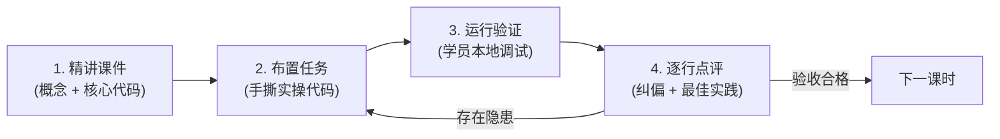

# 📘 Pydantic V2 互动式实战学习计划与通关指南

> **授课模式**：导师制一对一课件授课 ｜ 随堂手撕代码 ｜ 逐行 Code Review ｜ 拒绝死记文档  
> **适用对象**：具备 Java 工程师背景，正全面转型现代 Python 与 AI Agent 开发的开发者。  
> **核心基准**：严格基于 **Pydantic V2**（基于 Rust 重写的核心引擎），彻底规避 V1 废弃语法。

---

## 目录
- [一、 心智模型对齐（Java vs Pydantic V2）](#一-心智模型对齐java-vs-pydantic-v2)
- [二、 教学规则与闭环流程](#二-教学规则与闭环流程)
- [三、 详细课时规划与通关任务](#三-详细课时规划与通关任务)
  - [模块一：核心底座与数据建模（第 1 ~ 3 课）](#模块一核心底座与数据建模第-1--3-课)
  - [模块二：数据流转与契约导出（第 4 ~ 5 课）](#模块二数据流转与契约导出第-4--5-课)
  - [模块三：高级校验与业务防护（第 6 ~ 8 课）](#模块三高级校验与业务防护第-6--8-课)
  - [模块四：毕业实战与 Agent 闭环（第 9 课）](#模块四毕业实战与-agent-闭环第-9-课)
- [四、 学习进度打卡表](#四-学习进度打卡表)

---

## 一、 心智模型对齐（Java vs Pydantic V2）

| 维度 | Java 体系实现 | Pydantic V2 现代 Python 实现 | 核心心智差异 / Agent 价值 |
| :--- | :--- | :--- | :--- |
| **基础模型 / DTO** | POJO + Lombok (`@Data`, `@Getter`, `@Setter`) | 继承 `BaseModel` | 不仅是数据容器，默认具备自动数据转换与类型解析（Parsing）能力。 |
| **字段级约束校验** | Hibernate Validator (`@NotNull`, `@Size`, `@Pattern`, `@Min`) | `Field(...)` 配合 `ge`, `le`, `pattern`, `min_length` 等 | `Field.description` 是大模型理解工具参数的**关键 Prompt 来源**。 |
| **JSON 序列化与反序列化** | Jackson `ObjectMapper` / Gson | `model_validate` / `model_dump` | 由 Rust 编写的 `pydantic-core` 驱动，序列化速度提升 5~50 倍。 |
| **自定义校验逻辑** | 自定义 `ConstraintValidator` / 反序列化器 | `@field_validator` / `@model_validator` | 区分单字段清洗与多字段业务依赖关系校验，拦截非法脏数据。 |
| **通用响应封装** | 泛型类 `Result<T>` / `PageResponse<T>` | 泛型模型 `GenericModel` / `Generic[T]` | 强类型传递复杂嵌套数据，支持无缝 IDE 补全与静态检查。 |
| **接口契约导出** | SpringDoc / Swagger OpenAPI 注解 | `Model.model_json_schema()` | 直接生成符合 JSON Schema / OpenAPI 标准的元数据，给 Agent Function Calling 使用。 |

---

## 二、 教学规则与闭环流程

每个课时均严格遵循以下四步教学闭环：

1. **一课一授**：每次聚焦一个核心主题，讲透底层机制与设计哲学，拒绝知识点轰炸。
2. **随堂实操**：讲完立即动手写代码，在本地真实 Python 环境运行并反馈结果。
3. **逐行 Review**：导师对代码进行深度点评，剖析边界情况、异常防护及 Pythonic 规范。
4. **通关推进**：完全理解并交付合格代码后，打卡点亮进度，进入下一课。

---

## 三、 详细课时规划与通关任务

### 模块一：核心底座与数据建模（第 1 ~ 3 课）

#### 第 1 课：初识 BaseModel —— 心智重塑与类型推断
* **课件要点**：
  * Pydantic 的本质是 **Parsing（解析转换）** 而不仅是 Type Checking（类型检查）。
  * 继承 `BaseModel` 与 Python 3.10+ 类型注解（`int`, `str`, `bool`, `list`, `T | None`）。
  * 默认值处理与可变默认值（List/Dict）的安全机制。
* **对标 Java**：POJO 属性定义 + Lombok 基础能力。
* **手操任务**：编写基础用户实体，故意输入字符串型数字与可选字段，观察自动转换行为。
* **通关标准**：能清晰区分静态类型检查与 Pydantic 运行时解析的行为差异。

#### 第 2 课：Field 深度解析 —— 业务约束与 Agent 提示词灵魂
* **课件要点**：
  * `Field(...)` 常见参数：`default`, `default_factory`, `ge`, `le`, `min_length`, `max_length`, `pattern`。
  * `description` 属性在 AI Agent 中的战略意义（它就是 Function Calling 的 Prompt）。
  * 必填字段与选填字段的严格语法边界。
* **对标 Java**：Bean Validation 注解集合（`@Min`, `@Max`, `@Pattern` 等）。
* **手操任务**：编写包含手机号正则约束、价格范围限制、备注长度限制的“外卖配送订单约束模型”。
* **通关标准**：成功触发非法语义的 `ValidationError`，并理解各字段校验约束生效点。

#### 第 3 课：复合建模 —— 嵌套对象与通用泛型模型
* **课件要点**：
  * 模型中嵌套子模型（Object Graph 树状结构）。
  * 列表模型（`list[SubModel]`）与字典映射模型（`dict[str, SubModel]`）。
  * 泛型模型定义：利用 `typing.Generic` 与 `TypeVar` 打造企业级通用数据结构。
* **对标 Java**：复合实体类关联、`ApiResponse<T>` / `PageResult<T>`。
* **手操任务**：手写通用接口响应包装类 `ApiResponse[T]`，支持包装不同业务实体的通用序列化。
* **通关标准**：泛型类型被正确实例化，嵌套层级的字段校验全部生效。

---

### 模块二：数据流转与契约导出（第 4 ~ 5 课）

#### 第 4 课：数据双向流转 —— validate、dump 与驼峰/蛇形别名映射
* **课件要点**：
  * 反序列化入口：`model_validate(dict)` 与 `model_validate_json(json_str)`。
  * 序列化出口：`model_dump()` 与 `model_dump_json()`，精细控制参数（`exclude_none`, `exclude_unset`, `by_alias`）。
  * 别名系统：`Field(alias="camelCase")` 与 `ConfigDict(populate_by_name=True)` 处理前后端命名冲突。
* **对标 Java**：Jackson `@JsonProperty`、`ObjectMapper.readValue` / `writeValueAsString`。
* **手操任务**：解析来自前端的驼峰 JSON 字符串，映射到 Python 蛇形模型中，清洗后按驼峰格式导出非空字段 JSON。
* **通关标准**：掌握三种不同导出模式下数据字典的差异。

#### 第 5 课：模式导出 —— model_json_schema 与大模型 Function Calling 契约
* **课件要点**：
  * `model_json_schema()` 核心字段拆解（`title`, `type`, `properties`, `required`, `$defs`）。
  * OpenAPI 规范映射与大模型 `tools: [{"type": "function", ...}]` 的报文装配。
* **对标 Java**：Swagger 自动生成的 `swagger.json` / OpenAPI Spec。
* **手操任务**：定义一个数据库查询工具入参模型，一键导出 JSON Schema，并组装成符合 OpenAI 标准的 Tool 报文。
* **通关标准**：导出的 Schema 完全符合 JSON Schema Draft-07/2020-12 规范。

---

### 模块三：高级校验与业务防护（第 6 ~ 8 课）

#### 第 6 课：自定义单字段校验器 —— @field_validator 与脏数据清洗
* **课件要点**：
  * `@field_validator` 语法与类方法特性。
  * `mode="before"`（清洗原始脏数据）与 `mode="after"`（校验清洗后数据）的区别。
  * 数据归一化实战（例如自动去除前后空格、统一转大写、补齐国家码等）。
* **对标 Java**：自定义 `ConstraintValidator` / Jackson 自定义反序列化器。
* **手操任务**：编写针对统一社会信用代码/手机号的清洗校验器，把非标准输入自动规范化并校验合法性。
* **通关标准**：明确理解 `before` 与 `after` 的拦截时机与入参类型变化。

#### 第 7 课：跨字段联合校验与计算属性 —— @model_validator 与 @computed_field
* **课件要点**：
  * `@model_validator(mode="after")` 处理多字段互斥或时间逻辑依赖。
  * `@computed_field` 动态计算属性及其在 `model_dump()` 中的自动导出机制。
* **对标 Java**：类级别联合校验逻辑、动态 getter 字段与 JSON 序列化映射。
* **手操任务**：编写“酒店预订模型”，包含入住与离店日期，校验时间先后关系，并自动计算预订总天数与总金额。
* **通关标准**：非法时间范围抛出明确异常，合法输入自动派生计算字段并正确导出。

#### 第 8 课：异常防御与错误解析 —— 读懂 ValidationError 与错误定位
* **课件要点**：
  * `ValidationError` 异常内部核心属性剖析（`loc` 路径定位, `msg` 错误原因, `type` 错误类型, `input` 原始错误值）。
  * 深层嵌套模型报错的高效定位与人类友好格式转换。
* **对标 Java**：Spring 全局异常处理器 `MethodArgumentNotValidException` 统一错误响应封装。
* **手操任务**：构造包含多层嵌套错误的输入，捕获 `ValidationError`，并将其格式化为前端或大模型易读的扁平错误字典。
* **通关标准**：能从深层报错中精准提取出错字段路径（如 `orders -> 0 -> address -> phone`）。

---

### 模块四：毕业实战与 Agent 闭环（第 9 课）

#### 第 9 课：Agent 场景实战 —— 手写原生 Function Calling 校验与 Self-Correction（自愈重试）
* **课件要点**：
  * 真实 Agent 场景中大模型输出格式不可控的问题分析。
  * 结合 Pydantic 校验结果设计 Self-Correction（自愈重试）机制。
  * 生产级容错机制设计：当抛出 `ValidationError` 时，如何将具体错误反馈回传给大模型促使其自我修正。
* **对标 Java**：生产级分布式系统的熔断、降级与动态重试补偿机制。
* **手操任务**：模拟大模型返回缺失字段或类型错误的 JSON，编写自愈循环，自动拼接错误提示词促使大模型生成合法结构。
* **通关标准**：实现端到端的结构化数据提取与自愈重试机制闭环。

---

## 四、 学习进度打卡表

| 课时 | 核心知识点 | 状态 | 交付物/代码文件 | 完成时间 |
| :---: | :--- | :---: | :--- | :---: |
| **第 1 课** | 初识 BaseModel 与类型推断 | ✅ 已完成 | `src/pydantic/lesson_01_base_model.py` | 2026-10-09 |
| **第 2 课** | Field 约束与 Agent 提示词 | ✅ 已完成 | `src/pydantic/lesson_02_field_constraints.py` | 2026-10-09 |
| **第 3 课** | 嵌套模型与泛型 ApiResponse | ✅ 已完成 | `src/pydantic/lesson_03_nested_generic.py` | 2026-10-09 |
| **第 4 课** | 双向数据流转与别名映射 | ✅ 已完成 | `src/pydantic/lesson_04_data_transfer.py` | 2026-10-10 |
| **第 5 课** | JSON Schema 导出与 Tool 定义 | ✅ 已完成 | `src/pydantic/lesson_05_schema_export.py` | 2026-10-10 |
| **第 6 课** | @field_validator 数据清洗 | ✅ 已完成 | `src/pydantic/lesson_06_field_validator.py` | 2026-10-10 |
| **第 7 课** | @model_validator 与计算属性 | ✅ 已完成 | `src/pydantic/lesson_07_model_validator.py` | 2026-10-10 |
| **第 8 课** | ValidationError 结构解析 | ✅ 已完成 | `src/pydantic/lesson_08_error_handling.py` | 2026-10-10 |
| **第 9 课** | 毕业实战：Agent 自愈重试闭环 | ✅ 已完成 | `src/pydantic/lesson_09_agent_correction.py` | 2026-10-10 |
