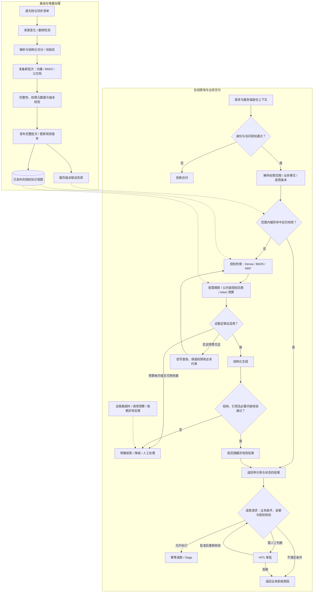

# LangChain 与企业 RAG 实战学习计划

> **学习起点**：具备 Java 后端背景，已学完 LangGraph，现在开始系统学习 LangChain。复用既有状态机、工具调用和人工审批知识，不重复讲授 LangGraph 入门。
> **学习目标**：以售后规章知识库为主线，掌握 LangChain 组件与数据流，逐步构建可评测、可追溯、具备权限与版本治理的 RAG 服务，最终接入 `sky_takeout_system`。
> **授课方式**：概念与接口说明 → 最小实验 → 接入业务场景 → 制造失败案例 → 修复与评测 → Code Review。
> **学习原则**：先做小而完整的闭环，再用真实问题驱动复杂度；每次增加一种机制，并记录质量、延迟与成本变化。

## 一、学习路线与能力边界

本计划包含 **2 个 LangChain 衔接单元 + 8 个 RAG 实战模块**。模块表示学习与验收范围，不等于一次授课；权限与同步、纠错、业务集成可以拆成多次练习。按验收结果推进，不以“代码运行成功”代替掌握。

0A/0B 与模块 1～8 的主线练习均需完成；精排、父子检索和纠错要完成对比实验，但是否在最终服务中启用由结果决定。明确标注为选修/扩展的反向 QA、摘要索引、扫描件 OCR、语义缓存及 Qdrant 对比，不阻塞主线验收。

| 阶段 | 学习重点 | 阶段完成标志 |
| :--- | :--- | :--- |
| A：LangChain 基础衔接 | 模型、消息、提示词、结构化输出、Runnable / LCEL、异步与流式 | 能解释各组件的输入输出，独立组合一个可测试的问答组件 |
| B：基础 RAG 闭环（模块 1～3） | 检索与生成、数据解析、持久化、权限和版本 | 能完成带引用的规章问答，用固定问题集定位错误，并验证数据访问边界 |
| C：企业工程演进（模块 4～8） | 检索增强、有限纠错、运行治理、业务接入 | 用对比实验选择增强机制，处理异常与更新，完成业务回归验收 |

### LangChain、LangGraph 与业务代码各负责什么

| 层次 | 主要职责 | 本计划中的应用 |
| :--- | :--- | :--- |
| LangChain 组件与集成 | 模型调用、提示词、文档、Embedding、向量存储、Retriever、输出处理 | 构建检索与生成节点内部的数据处理过程 |
| LangGraph | 状态传递、条件分支、有限重试、人工介入等流程编排 | 在模块 6 复用已学知识，编排纠错与降级流程 |
| 业务服务 | 身份与权限、规则适用性、金额计算、授权审批、事务执行 | 校验检索结果能否用于当前订单，并通过既有业务流程处理退款 |

学习 LCEL 时，同时用普通 Python 函数表达同一条数据流，理解组合接口的作用。优先掌握当前任务需要的接口，复杂逻辑可以放在可测试的普通函数中。

## 二、技术栈与环境约定

| 组件 | 学习主线 | 使用约定 |
| :--- | :--- | :--- |
| Python 与依赖 | 沿用各项目配置，以 `uv.lock` 复现环境 | 当前 `hello` 指定 Python 3.14，`sky_takeout_system` 指定 3.12；新增依赖时核对两端兼容性，目标代码需在业务项目环境验证 |
| LangChain | `langchain-core`、所需模型/存储集成包、文本切分组件 | 按模块引入依赖，记录实际安装版本；以锁定版本的接口为准，不混用不同代际教程代码 |
| 生成模型 | 沿用可用的 DeepSeek 接口或现有模型配置 | 模型标识、地址、密钥走配置；先验证结构化输出、流式、超时行为，记录评测时的模型配置 |
| Embedding | 硅基流动（SiliconFlow）提供的 Embedding 模型（如 `BAAI/bge-m3`），通过 OpenAI 兼容接口调用 | 模型标识、Base URL、API Key 统一走环境变量配置；记录模型版本、向量维度和批次限制；先测小批量耗时，再扩大语料；精排模型单独选择和验证 |
| 向量存储 | 基础阶段使用 Chroma 持久化 | 完成主线后可选 Qdrant 对比实验；先保持业务检索接口稳定，再评估替换收益 |
| 关键词与排序 | BM25、RRF、按需引入 Reranker | 学习中文分词、编号规范化与候选去重；各路分数分别解释 |
| 缓存与服务 | Redis Async、既有业务服务框架 | 先实现精确缓存，再按证据决定是否增加语义缓存 |
| 测试与观测 | pytest、固定评测集、结构化日志与阶段耗时 | 从模块 1 起保留基线；自动评分工具作为后续增强 |

本次计划修订不更改运行环境或安装依赖。具体版本与资源需求在对应模块开始时确认。

## 三、LangChain 基础衔接单元

| 单元 | 核心内容 | 练习与验收 | 状态 |
| :--- | :--- | :--- | :--- |
| **0A：模型、消息与输出** | Chat Model；System / Human / AI / Tool 消息的职责；提示词模板；文本输出与结构化输出；调用配置 | 用固定售后案例构建问答组件；解释输入消息和返回对象；结构化输出缺字段或类型错误时走明确错误分支；密钥不写入代码和日志 | 进行中 |
| **0B：组件组合与执行方式** | Runnable 输入输出；LCEL 串联与并行；`invoke` / `batch` / `stream` 及异步调用；超时、重试与日志 | 用普通函数和 LCEL 实现同一流程；展示中间数据；验证单次失败、并发限制与取消处理；模型与检索组件可替换为测试替身 | 待开始 |

授课时明确区分模型原生结构化输出、工具调用结构化输出与文本解析，按实际模型能力选择实现。Pydantic 验证数据结构，不保证事实、引用或业务结论正确。模型接口与结构化输出能力参考 [LangChain Models 官方文档](https://docs.langchain.com/oss/python/langchain/models)。

## 四、8 个 RAG 实战模块

### 模块 1：最小 RAG 闭环、Embedding 与评测基线

**学习内容**：`Document`、Embedding、向量存储与 Retriever 的职责；检索后生成的数据流；上下文注入；基础引用与拒答。用 NumPy 实验理解余弦相似度、归一化及距离方向。

**练习**：准备少量售后 Markdown 规章，完成“加载 → 切分 → 向量化 → 检索 → 生成 → 引用”。先用无敏感信息的本地合成数据，完整权限机制在模块 3 实现。保留现有 `lesson_01_cosine_similarity.py` 作为数学实验。

**验收**：

- 固定样例覆盖“有依据回答、无依据拒答、相近但不适用的条款”；能查看检索片段及其来源。
- 建立首批约 50～100 条人工检查过的问题，区分开发集与保留测试集；每条有预期依据或拒答理由。
- 保存初始检索、答案、引用、延迟与模型配置，后续模块沿用同一基线。
- 解释相似度不是正确概率；阈值在开发集标定，不把 `0.30` 或其他数值当通用安全线。

### 模块 2：文档解析、结构化切分与表格

**学习内容**：加载器与切分器的分工；标题层级、token 长度、重叠窗口；PDF 文本解析；表格的表头、单位、脚注和适用条件；来源定位。

**练习**：先比较 Markdown 的固定长度与层级切分，再加入文本型 PDF 和跨页表格样例。扫描件 OCR 作为扩展，需单独记录解析质量。

**验收**：

- 复现并修复“数字被召回，但表头、单位或例外条件丢失”的问题。
- 大表允许按行组拆分，但每组保留解释数据所需的信息，可回溯完整表格。
- 对同一问题集比较至少两种切分方案，记录长度、召回与上下文成本。
- 引用能定位到文档及章节/页码；解析失败的文档有可追踪记录，不静默入库。

### 模块 3：持久化、权限与增量版本治理

**学习内容**：向量库操作与 metadata 过滤；稳定文档 ID、chunk ID、内容指纹、同步清单；租户与角色权限；有效期、索引批次及发布状态。

**练习**：先完成持久化与重复导入，再加入权限测试，最后实现新增、变更、删除和发布。文档与块级哈希用于识别变化；解析器、切分器或 Embedding 配置变化也需判断是否重建。

**验收**：

- 相同来源重复导入不增加重复块；文档变更、删除后，查询结果按发布规则变化。
- 同步中断可以安全重跑；未完成的索引批次不能对外可见；有回退到上次完整发布的方案。
- 权限来自服务端验证的身份上下文，默认拒绝缺失权限的访问；普通角色无法检索内部文档。
- 区分“规则失效、历史归档、源文档删除”；按业务时间选择适用版本，历史订单仍可追溯当时规则。
- 增加 BM25、父文档或缓存后，继续扩展同一组权限、更新与删除回归用例。

Metadata ACL 是逻辑访问隔离；更强的存储隔离按实际需求另行设计。共享集合的分区方式可参考 [Qdrant 多租户文档](https://qdrant.tech/documentation/manage-data/multitenancy/)。

### 模块 4：混合检索与结果融合

**学习内容**：BM25、中文分词、术语和编号处理；Dense 检索与关键词检索的差异；RRF 按排名融合；候选去重与检索预算。

**练习**：对“菜名、赔付条款编号、自然语言同义表达”建立失败样例，分别运行 BM25、Dense、Hybrid 三组实验。真实订单状态与金额仍从授权业务接口查询，订单号不作为规章向量检索的替代入口。

**验收**：

- 分类型比较 Recall@K、排名质量和耗时，解释哪些查询从混合检索获益。
- 两路召回使用一致的权限、适用版本和发布批次；更新与删除后两路结果一致。
- 不直接相加 BM25 分数和余弦分数；不将融合分数解释成可信概率。
- 区分“原始候选没找到”与“融合排序挤掉了正确条款”，能从日志定位。

### 模块 5：精排、父子检索与上下文组织

**学习内容**：Cross-Encoder 精排；Small-to-Big；父文档回表；去重、上下文 token 预算与截断顺序。反向 QA、摘要索引作为选修。

**练习**：先在模块 4 基线上单独增加精排，再单独验证父子检索，最后测试组合。可先对子块精排后扩展必要父内容，避免默认把完整长章节全部送入模型。

**验收**：

- 每个增强都有独立对比结果，包括收益、失败样例、精排耗时和输入 token 数。
- 回表时重新校验父文档权限、版本与发布状态，不能通过子块命中绕过访问边界。
- 同一父文档多次命中能去重；长章节截断后仍保留适用条件及来源。
- 选做反向 QA 时，生成的问题只用作检索入口，答案依据仍来自原始文档；记录额外生成与索引成本。

### 模块 6：LangGraph 综合应用——有限纠错与可验证输出

**学习内容**：复用 LangGraph 编排相关性判断、查询改写、重检索、引用校验与降级；区分结构校验、引用有效性、忠实度与业务正确性。

**练习**：在固定检索流程上增加可关闭的纠错分支。初始设定最多 2 次重新检索，并设置整条请求的耗时与模型调用预算；不重复讲图的基础语法。

**验收**：

- 无答案、查询改写无收益、预算耗尽、模型超时、结构解析失败和审计失败都能终止并返回明确状态。
- 查询改写只能改变检索文本，不能改写服务端权限、订单实体及规则适用时间。
- 引用 ID 必须来自当前请求获授权的证据集合；检查引用是否实际支持结论，而不仅是存在。
- 在含错误引用、冲突规则及文档提示注入的样例上验证；文档内容作为资料处理，不能授予权限或触发退款工具。
- 对比启用和关闭纠错后的正确率、拒答率、延迟及调用成本，决定是否默认开启。

本模块是借鉴 CRAG 的纠错工作流，不承诺消除幻觉。原始 CRAG 还涉及知识精炼与网页搜索；内部规章场景默认只使用授权知识源。[CRAG 原论文](https://arxiv.org/abs/2401.15884)

### 模块 7：服务化、观测、并发与缓存治理

**学习内容**：异步 I/O、并发限流、超时取消、依赖故障；检索/精排/生成阶段耗时；精确缓存、失效联动、击穿保护。语义缓存作为选修。

**练习**：先记录无缓存基线，再增加 Redis 精确缓存。缓存查询前完成鉴权与适用版本解析；缓存只保存通过校验的结果，命中时仍检查权限与版本有效性。

**验收**：

- 缓存范围覆盖租户、有效权限范围、规则/索引版本、必要业务实体或状态，以及影响答案的模型与提示词版本。
- 文档删除、权限撤销、规则发布及相关订单状态变化后，旧缓存不会继续作为有效答案返回；TTL 只作补充。
- 区分精确命中、语义命中、未命中，记录端到端 p50/p95、吞吐、错误率与单次成本，并注明硬件、数据量、并发和冷热状态。
- Redis 故障可绕过缓存走授权检索；检索或模型不可用时返回明确降级结果。
- 流式场景明确校验与输出顺序：最终业务结论通过校验后再交付；可先发送进度事件，避免事后审计无法收回已发送错误答案。

选做语义缓存时，查询向量化耗时计入端到端指标，增加“表达相近但金额、条件或订单不同”的误命中测试。是否保留由准确性与延迟实测决定，不预设 10～15ms 承诺。

### 模块 8：接入售后系统与最终回归验收

**学习内容**：把实验能力收敛成稳定服务接口，接入 `Refund Officer`；明确 RAG、业务规则、授权审批和 Saga 的边界。

**目标链路**：授权查询订单事实 → 检索适用规章 → 返回条款及引用 → 业务代码验证条件并计算金额 → 按规则执行退款或进入 HITL 审批。

**验收**：

- 输出至少包含处理状态、回答/拒答原因、证据标识、适用规则版本与请求追踪 ID；缺少依据不能输出可直接执行的退款结论。
- 金额通过确定性业务规则计算，并验证退款上限、订单状态与规则有效期；需要模型辅助判定且无法确定时进入人工处理。
- 复用既有授权、幂等和 Saga 机制；对重复请求、审批拒绝、执行失败与补偿做回归验证，不让生成文本直接决定资金动作。
- 运行保留测试集、权限/删除测试和并发场景，给出质量、性能与成本报告，列明剩余失败样例。
- 形成启动说明、配置说明、数据更新/回滚步骤与故障定位说明，在业务项目的 Python 环境完成验证。

## 五、统一评测与进阶规则

评测从模块 1 开始，每个模块追加针对性样例。数据行至少包含 `case_id`、问题、角色/租户、必要业务事实与时间、预期证据 ID、关键答案要点或拒答理由。模块 1 暂用合成身份与规则数据；模块 3 起这些字段参与真实访问过滤。

| 维度 | 观察指标 | 使用方式 |
| :--- | :--- | :--- |
| 检索 | Recall@K；需要时增加 MRR 或 nDCG | 按术语、语义改写、表格等类别报告；标注依据尽量使用稳定条款 ID，避免切分变化使对比失效 |
| 生成 | 关键事实正确率、引用正确性与完整性、忠实度 | 初期人工检查；后续模型评分需用人工样例校准，不能直接等同业务正确性 |
| 拒答与边界 | 无答案时正确拒答、可回答问题被误拒、冲突规则处理 | 同时看错误回答和过度拒答，避免靠一律拒答提高表面可靠性 |
| 权限与治理 | 越权返回、删除残留、错误版本、缓存误命中 | 纳入确定性回归测试，任何已知失败都阻止该版本交付 |
| 业务与运行 | 金额/状态校验、幂等；p50/p95、错误率、吞吐、成本 | 在指定环境与业务样例下验收，质量与运行开销一起比较 |

每次实验保存数据集版本、代码版本、语料与索引版本、模型配置、提示词及检索参数。开发集用于调整参数，保留测试集用于阶段验收；一旦用测试样例调参，就将其纳入开发集并补充新的保留样例。

首轮基线之后，为不同问题类别设定并记录质量目标、允许退化范围与运行预算。每次增强先声明要改善哪类失败，再比较结果；收益不足的机制可以关闭，并在实验报告中记录原因。越权、无效引用、错误业务金额等已知回归失败优先修复，有限样例全部通过也不等于证明所有输入都安全。

忠实度表示回答与检索上下文的一致程度，不能替代对过期规则、适用条件或业务计算的检查。[Ragas 指标说明](https://docs.ragas.io/en/latest/concepts/metrics/available_metrics/)

## 六、目标架构与演进顺序

下图表示后期目标架构。模块 1 先实现直接检索与生成，随后逐步加入权限治理、混合检索和缓存；精排、父子扩展及模型审计等增强均可独立关闭。身份校验、访问控制和必要业务校验不可绕过。

跨存储发布可用统一批次标识与已发布版本指针协调；具体实现由模块 3 验证，模块 4 加入 BM25 后重跑同步测试。没有成功完成鉴权时，依赖降级也不能返回受保护内容。规章问答可以在返回结果处结束；只有退款请求进入后续业务决策。

## 七、交付物、进度与学习记录

以下除已有余弦实验外，均为计划中的交付物；文件名是建议，不表示已实现。练习入口应调用逐步沉淀的共享组件，避免每课复制一套检索逻辑。

| 单元 / 模块 | 建议交付物 | 当前进度 |
| :--- | :--- | :--- |
| 0A | `hello/src/rag_study/lesson_00a_models_and_outputs.py` | 待开始 |
| 0B | `hello/src/rag_study/lesson_00b_runnables.py` | 待开始 |
| 1 | 保留 `hello/src/rag_study/lesson_01_cosine_similarity.py`；新增 `lesson_01_basic_rag.py` 与基线报告 | 原数学实验进行中；完整闭环与评测待完成 |
| 2 | `hello/src/rag_study/lesson_02_chunking_and_table.py` 与切分对比报告 | 待开始 |
| 3 | `hello/src/rag_study/lesson_03_vectordb_rbac_idempotent.py` 与治理测试 | 待开始 |
| 4 | `hello/src/rag_study/lesson_04_hybrid_search.py` 与三组召回对比 | 待开始 |
| 5 | `hello/src/rag_study/lesson_05_rerank_parent_child.py` 与独立增强对比 | 待开始 |
| 6 | `hello/src/rag_study/lesson_06_corrective_rag_graph.py` 与失败路径测试 | 待开始 |
| 7 | `hello/src/rag_study/lesson_07_cache_and_observability.py` 与压测报告 | 待开始 |
| 8 | `sky_takeout_system/src/app/services/rag/` 与集成回归报告 | 待开始 |

建议在 `hello/src/rag_study/` 下创建 `data/` 保存样例文档、`evals/` 保存评测集及评测入口、`reports/` 保存实验报告；治理与组件测试放入 `hello/tests/rag/`。业务集成后在 `sky_takeout_system/tests/` 中增加对应回归测试。上述目录按模块需要创建。

每个模块结束记录五件事：**学会的接口、输入输出约定、复现的失败案例、改动前后数据、保留或放弃该方案的理由**。Code Review 关注抽象边界、异常路径与证据，而不仅是代码风格。

下一步从 **0A** 开始；已有余弦实验保留，在模块 1 中与完整检索链路串联。0A/0B 中已熟悉的内容可通过练习验收后快速推进。
