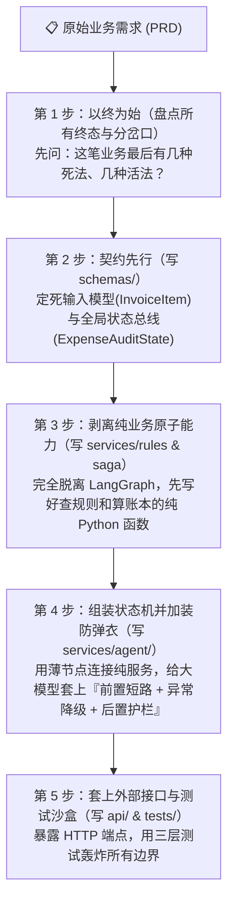
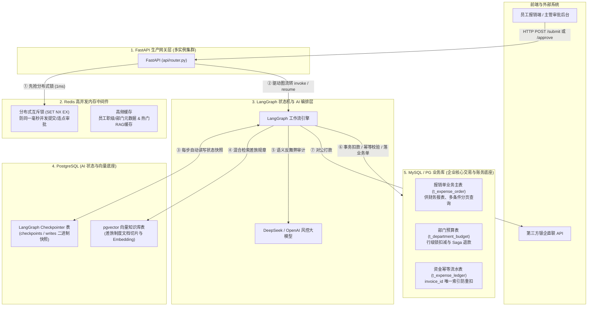

# 🏛️ 企业级 AI Agent 项目架构设计与生产落地全景指南
> **定位**：从“拿到一份模糊的业务需求 (PRD)”到“交付可抗高并发、防大模型幻觉、具备完整 MySQL / PostgreSQL / Redis 落库能力的生产级 AI 系统”的方法论与工程规范手册。

---

## 目录
1. [第一部分：从需求到代码的“五步架构拆解法”（开发者核心思维模型）](#第一部分从需求到代码的五步架构拆解法开发者核心思维模型)
2. [第二部分：生产环境数据库与中间件映射（MySQL / PostgreSQL / Redis 实战分工）](#第二部分生产环境数据库与中间件映射mysql--postgresql--redis-实战分工)
3. [第三部分：GitHub 标杆项目对标与企业级标准目录规范](#第三部分github-标杆项目对标与企业级标准目录规范)
4. [第四部分：生产级 Python / LangGraph 命名与防御性编程红线清单](#第四部分生产级-python--langgraph-命名与防御性编程红线清单)
5. [第五部分：新 AI 项目从 0 到 1 开局 6 步标准 SOP](#第五部分新-ai-项目从-0-到-1-开局-6-步标准-sop)

---

## 第一部分：从需求到代码的“五步架构拆解法”（开发者核心思维模型）

面对复杂的 AI Agent 需求，切忌“想到哪写到哪”。高级工程师永远遵循 **“以终为始、契约先行、算编分离、三层护栏、外壳守卫”** 的五步推演法：



### 第 1 步：以终为始 —— 先盘点“有几种结局”，倒推“有几个路口”
- **核心动作**：不写代码，先在纸上列出业务单据走到生命周期终点时，一共有哪几种确定性的业务终态（`final_status`）。
- **本案实例**：
  1. `PAID_SUCCESS`（正常打款到账）👉 对应终点节点 `success_node`
  2. `PAYOUT_FAILED_COMPENSATED`（扣完预算但银行故障，触发 Saga 逆向退回预算）👉 对应终点节点 `compensate_node`
  3. `REJECTED_BY_RISK_CONTROL`（初审触犯反舞弊红线，一票否决）👉 对应终点节点 `archive_node`
  4. `REJECTED_BY_MANAGER`（主管人工审批驳回）👉 对应终点节点 `archive_node`
  5. `ABORTED_INSUFFICIENT_BUDGET`（部门预算池余额不足，中止打款）👉 对应终点节点 `archive_node`
- **倒推路由**：为了到达上述 5 种结局，图中必然需要 **4 个条件分支路口（Conditional Routers）**：
  - `risk_router`（风控分流：自动过 / 转人工 / 驳回归档）
  - `approval_router`（主管审批分流：同意去扣预算 / 驳回去归档）
  - `budget_router`（预算扣减分流：扣款成功去打款 / 余额不足去归档）
  - `transfer_router`（银行打款分流：成功去完结 / 失败去 Saga 补偿）

### 第 2 步：契约先行（Schema-First）—— 先定“数据长什么样”，再写逻辑
- **核心动作**：任何项目第一行代码永远写在 `schemas/` 目录：
  1. **外部输入防腐契约（Pydantic `BaseModel`）**：凡是来自用户前端、Webhook 回调、第三方接口的数据（如 `InvoiceItem`、`ManagerDecision`），必须用 Pydantic 锁死字段类型、枚举范围（`StrEnum`）与数值边界（如 `Field(..., gt=0)`）。
  2. **全局状态机总线契约（LangGraph `TypedDict`）**：
     - **职责分离铁律**：给条件边 Router 判断用的**瞬态控制信号灯**（`risk_verdict`、`manager_decision`、`budget_deducted`、`bank_transfer_success`）必须与**业务终态字段**（`final_status`）严格分开，严禁拿 `final_status` 当中间路由判断条件。
     - **追加型审计字段**：审计流水 `audit_trail` 必须使用 `Annotated[list[str], operator.add]`，保证每个节点只用返回当前步骤新增的日志列表，由 LangGraph 自动合并追加。

### 第 3 步：剥离纯业务服务（Service Layer）—— 让凯撒的归凯撒，让图的归图
- **核心动作**：假装项目没有使用 LangGraph，先把核心业务计算、规则核验、账本操作写成**纯 Python 函数/类**（放在 `services/rules/`、`services/saga/`、`services/rag/`）。
- **核心收益**：
  1. **极速可测性**：无需启动图或调用大模型，在 `tests/unit/` 中用几十毫秒即可把所有业务边界测透；
  2. **平滑演进性**：未来将 `policy_checker.py` 从字典规则升级为向量 RAG 检索，或将 `payout_service.py` 从内存字典升级为 MySQL 事务，外层的 LangGraph 节点与拓扑图无需修改一行代码。

### 第 4 步：组装状态机并加装“三明治风控护栏”（Agent Layer）
- **薄节点原则**：每个 `node` 函数控制在 20~40 行以内，只负责：`从 state 取参 -> 调底层 service / LLM / interrupt -> 写回 state 与 audit_trail`。
- **生产级防御性设计**：
  1. **入口节点状态归零**：在入口节点（`check_invoice_policy_node`）将标准化后的 `invoice_item.model_dump()` 写回 `state`，并将 `manager_decision`、`budget_deducted`、`bank_transfer_success`、`compensation_stack` 显式重置，防止同一 `thread_id` 重入时残留脏状态。
  2. **大模型“三明治护栏架构”（前置短路省钱 + 中间容灾兜底 + 后置护栏保命）**：
     - **第一关（前置确定性硬红线短路）**：结构化规则已经判定 `is_hard_violation=True`（如周末无加班单餐饮）时，0ms 直接返回 `REJECTED`，不花一分钱 Token。
     - **第二关（LLM 语义审计 + `try...except` 容灾降级）**：模型调用必须配置 `timeout` 与 `max_retries`；一旦发生网络超时或 API 故障，捕获异常并自动降级为 `FLAGGED_NEED_APPROVAL` 交由人工审批兜底，绝不崩溃或盲目放行。
     - **第三关（LLM 后置确定性护栏）**：严防 Prompt 注入攻击与模型幻觉越权！即使 LLM 返回了 `AUTO_APPROVED`，Python 代码也必须复核 `if verdict == "AUTO_APPROVED" and (not is_compliant or amount > 500):`，强制将其扭转为 `FLAGGED_NEED_APPROVAL`。**铁律：大模型只有往下拦截权，绝无突破制度红线的越权放行权！**

### 第 5 步：封装 API 状态守卫网关与三层自动化测试（API & Tests Layer）
- **API 网关的 3 个核心职责**：
  1. **共享 Checkpointer 单例**：确保 `/submit` 与 `/{thread_id}/approve` 跨请求访问同一个持久化状态源；
  2. **快照翻译器（`_build_workflow_response`）**：通过 `snapshot = graph.get_state(config)` 判断 `snapshot.next` 是否非空，区分 `PENDING_APPROVAL`（挂起态，并从 `snapshot.tasks[0].interrupts[0].value` 提取中断载荷）与 `COMPLETED`（完结态）；
  3. **HTTP 404 / 409 状态守卫**：防重复提交同一单据（409）、防审批不存在的单据（404）、防对未停留在 `human_approval` 断点的单据越权或重复调用 `Command(resume=...)`（409）。

---

## 第二部分：生产环境数据库与中间件映射（MySQL / PostgreSQL / Redis 实战分工）

### 2.1 代码内存变量与生产中间件一对一映射表

| 代码中的组件 | 本地沙盒“内存替身” | 生产环境真实落库组件 | 生产环境技术选型原因 |
| :--- | :--- | :--- | :--- |
| **1. 状态机快照持久化**<br>(`services/agent/graph/graph.py`) | `InMemorySaver()` | **PostgreSQL**<br>(`AsyncPostgresSaver`) | 人工审批可能跨天唤醒，且生产环境为多实例集群（K8s Pods），必须将 `StateSnapshot` 存入共享的 PostgreSQL 表（`checkpoints` / `checkpoint_writes`），防重启丢失。 |
| **2. 差旅制度知识库**<br>(`services/rules/policy_checker.py`) | `HOTEL_STANDARD` 字典 | **PostgreSQL (`pgvector`)**<br>或 Milvus / Qdrant | 将非结构化《企业差旅管理规范》切块（Chunking）并向量化落库，支持稠密向量（Dense）+ 全文关键词（BM25）混合检索。 |
| **3. 部门预算池余额**<br>(`services/saga/payout_service.py`) | `department_budgets` 字典 | **MySQL / PG 业务表**<br>`t_department_budget` | 涉及资金扣减，必须依赖关系型数据库 **ACID 事务与行级锁**（`UPDATE t_department_budget SET balance = balance - :amt WHERE dept = :dept AND balance >= :amt`）。 |
| **4. 扣款与打款幂等账本**<br>(`services/saga/payout_service.py`) | `budget_deducted_ledger` (`set`) | **MySQL / PG 资金流水表**<br>`t_expense_ledger` | 将 `invoice_id` 设为数据库表的 **`UNIQUE KEY`（唯一索引）**，利用数据库引擎级唯一约束杜绝并发重复扣款与重复打款。 |
| **5. 高并发防抖与互斥**<br>(`api/router.py`) | `get_state()` 检查 | **Redis 分布式锁**<br>(`SET lock:inv:{id} 1 NX EX 30`) | 防止同一毫秒内并发连点提交或连点审批穿透进大模型与扣款节点。 |

### 2.2 生产环境黄金三角架构拓扑图（FastAPI + Redis + PostgreSQL + MySQL）



### 2.3 生产架构避坑铁律：为什么绝不能用 LangGraph 的 `checkpoints` 表代替业务主表？
- **原因**：LangGraph 的 `PostgresSaver` 将 `State` 序列化为二进制块（`msgpack` / `bytea`）存储，仅支持按 `thread_id` 主键检索，**无法在数据库层面对业务字段（如按部门、城市、金额区间、时间范围）建索引或执行 `WHERE / GROUP BY / ORDER BY` 分页查询**。
- **生产标准做法**：
  - **业务主表（`t_expense_order`）**：存储结构化业务单据状态，供后台管理列表分页查询、财务统计报表使用；
  - **LangGraph Checkpointer 表（`checkpoints`）**：专门供 LangGraph 引擎在 `Command(resume=...)` 时按 `thread_id` 恢复图运行栈帧使用。

---

## 第三部分：GitHub 标杆项目对标与企业级标准目录规范

### 3.1 GitHub 三大工业级参考标杆
1. **[`JoshuaC215/agent-service-toolkit`](https://github.com/JoshuaC215/agent-service-toolkit)**：`LangGraph + FastAPI + PostgreSQL (AsyncPostgresSaver & pgvector) + Docker + Pytest` 全栈生产工程模板。
2. **[`zhanymkanov/fastapi-best-practices`](https://github.com/zhanymkanov/fastapi-best-practices)**：企业级 FastAPI 分层、依赖注入、`pydantic-settings` 配置管理、SQLAlchemy 异步会话规范。
3. **[`langchain-ai/retrieval-agent-template`](https://github.com/langchain-ai/retrieval-agent-template)**：LangGraph 官方模块拆分规范（`prompts.py`、`state.py`、`nodes/`、`edges/`、`graph.py`）。

### 3.2 企业级 AI Agent 标准工程目录树

```text
enterprise_expense_system/
├── .env.example                       # [配置模板] 环境变量样板 (DB_URL, REDIS_URL, DEEPSEEK_API_KEY)
├── pyproject.toml                     # [包管理] uv 依赖声明与 pytest/ruff 配置
├── docker-compose.yml                 # [容器编排] 本地一键启动 PostgreSQL(pgvector) + Redis
├── PROJECT_REQUIREMENTS.md            # [需求文档] 业务需求与架构规格说明书
├── ENTERPRISE_AI_PROJECT_ARCHITECTURE_GUIDE.md  # [架构手册] 本工程方法论指南
│
├── data/                              # 【离线数据与知识库语料层】
│   └── policies/                      #   - 企业差旅规章制度 Markdown / PDF 原文
│
├── core/                              # 【1. 全局基础设施底座层】(可选演进：存放全局配置与连接池)
│   ├── config.py                      #   - 基于 pydantic-settings 的强类型配置中心
│   ├── database.py                    #   - 数据库异步连接池 (SQLAlchemy / AsyncPostgresPool)
│   └── redis_client.py                #   - Redis 客户端与分布式锁封装
│
├── schemas/                           # 【2. 领域数据契约层 (DTO & State)】
│   ├── enums.py                       #   - 强类型枚举 (EmployeeTier, InvoiceCategory) —— 严禁叫 enum.py
│   ├── invoice.py                     #   - 发票与主管审批 Pydantic 契约 (InvoiceItem, ManagerDecision)
│   └── state.py                       #   - LangGraph 全局状态契约 (ExpenseAuditState)
│
├── services/                          # 【3. 核心业务与 AI 编排层】
│   ├── rag/                           #   [3.1 RAG 向量知识库模块 (Phase 2)]
│   │   ├── ingestion.py               #     * 文档切分与向量化入库
│   │   └── retriever.py               #     * 混合检索与重排序 (Rerank)
│   │
│   ├── rules/                         #   [3.2 确定性规则计算引擎]
│   │   └── policy_checker.py          #     * 差旅标准与硬红线核验
│   │
│   ├── saga/                          #   [3.3 财务分布式事务服务]
│   │   └── payout_service.py          #     * 部门预算预扣、银企打款、幂等账本与 LIFO 逆向补偿
│   │
│   └── agent/                         #   [3.4 LangGraph 状态机编排引擎]
│       ├── prompts.py                 #     * 集中管理所有 System Prompts
│       ├── nodes/                     #     * 图节点函数 (统一以 _node.py 结尾)
│       │   ├── check_invoice_policy_node.py
│       │   ├── risk_assessment_node.py
│       │   ├── human_approval_node.py
│       │   ├── deduct_budget_node.py
│       │   ├── execute_bank_transfer_node.py
│       │   ├── compensate_node.py
│       │   ├── archive_node.py
│       │   └── success_node.py
│       ├── edges/                     #     * 条件边路由函数 (统一以 _router.py 结尾)
│       │   ├── risk_router.py
│       │   ├── approval_router.py
│       │   └── payout_router.py
│       └── graph/                     #     * 状态图编译与单例导出
│           └── graph.py
│
├── utils/                             # 【4. 通用工具层】
│   ├── model.py                       #   - 大模型客户端工厂 (get_llm，含 timeout 与 max_retries)
│   └── graph_utils.py                 #   - Mermaid 拓扑图导出工具
│
├── api/                               # 【5. FastAPI 生产接口网关层】
│   ├── schemas.py                     #   - HTTP 请求与统一工作流响应模型 (SubmitExpenseRequest, ExpenseWorkflowResponse)
│   ├── router.py                      #   - 核心 RESTful 路由 (/submit, /{thread_id}/approve, /{thread_id})
│   └── main.py                        #   - FastAPI 实例入口与账本监控端点
│
└── tests/                             # 【6. 三层自动化测试金字塔】
    ├── conftest.py                    #   - 全局 autouse 隔离夹具 (每次测试自动重置预算池与幂等账本)
    ├── unit/                          #   - 第 1 层：毫秒级纯函数与契约单测 (0 网络/Token 消耗)
    │   ├── test_invoice_schema.py
    │   ├── test_policy_checker.py
    │   └── test_payout_idempotency.py
    ├── integration/                   #   - 第 2 层：Mock LLM 状态机路由、HITL 与 FastAPI 接口集成测试
    │   ├── test_graph_routing.py
    │   ├── test_graph_hitl.py
    │   └── test_graph_saga.py
    └── e2e/                           #   - 第 3 层：真实 DeepSeek 大模型端到端语义审计测试
        └── test_live_llm_audit.py
```

---

## 第四部分：生产级 Python / LangGraph 命名与防御性编程红线清单

1. **严禁与 Python 标准库模块同名**：
   - 文件名绝不能叫 `enum.py`、`types.py`、`logging.py`、`operator.py`、`json.py`，统一加复数（如 `enums.py`），防止循环导入 Shadowing 崩溃。
2. **命名后缀高度统一**：
   - 图节点文件与函数名统一以 `_node` 结尾（如 `human_approval_node.py`），避免与底层 Service 函数（如 `execute_bank_transfer`）重名冲突；
   - 条件边函数统一以 `_router` 结尾（如 `risk_router.py`），并在返回值标注严格的 `from typing import Literal`。
3. **严格遵守 PEP 8 大小写规范**：
   - `PascalCase`（大驼峰）仅用于 `class`（如 `InvoiceItem`、`ExpenseAuditState`）；
   - 模块级配置字典与常量必须使用 `UPPER_SNAKE_CASE`（如 `HOTEL_STANDARD`、`SUPER_CITIES`）；
   - 函数、方法、变量、模块文件名一律使用 `snake_case`（小写加下划线）。
4. **杜绝模块间“魔术字符串耦合”**：
   - 上下游节点之间严禁靠匹配中文提示词子串（如 `"禁止报销" in violation_reason`）做逻辑分支，必须通过显式的结构化布尔/枚举字段（如 `"is_hard_violation": True`）通信。
5. **杜绝在模块顶层直接发起网络连接或实例化重对象**：
   - 严禁在 `.py` 文件顶层直接写 `llm = get_llm()` 或发起数据库连接，必须在函数内部按需获取或通过依赖注入，保证单元测试 `import` 时 0 副作用且支持 `monkeypatch` 替换。
6. **财务金额计算精度保护**：
   - 涉及金额加减必须使用 `round(val, 2)` 或 `decimal.Decimal`，严防 IEEE 754 浮点数尾差（如 `49799.99999999999`）导致边界判断失误。

---

## 第五部分：新 AI 项目从 0 到 1 开局 6 步标准 SOP

以后立项任何新的企业级 AI Agent 系统，严格按以下 6 步推进：

- [ ] **Step 1（建骨架）**：创建 `schemas/`、`services/{rules, rag, saga, agent}`、`utils/`、`api/`、`tests/{unit, integration, e2e}` 目录。
- [ ] **Step 2（立契约）**：先盘点业务的所有终态（`final_status`）和分岔路口，写出 `schemas/enums.py`、输入模型与 `schemas/state.py`。
- [ ] **Step 3（写纯服务 + 跑单测）**：脱离 LangGraph，先写好底层计算/数据库/检索纯函数，并用 `tests/unit/` 在 0.1 秒内测通所有边界。
- [ ] **Step 4（搭状态机 + 加三明治护栏）**：编写 `nodes/`（加装入口状态归零、前置硬红线短路、LLM `try...except` 容灾降级、LLM 后置防越权护栏）与 `edges/`，在 `graph.py` 完成装配。
- [ ] **Step 5（写集成测试）**：在 `tests/integration/` 中使用 `monkeypatch` 注入假模型，100% 覆盖正常路径、Prompt 注入拦截路径、LLM 超时降级路径、`interrupt()` 挂起与 `Command(resume=...)` 恢复路径。
- [ ] **Step 6（封 API 网关 + 跑端到端）**：编写 `api/schemas.py`、`api/router.py`（含 `_build_workflow_response` 快照解析与 HTTP 404/409 状态守卫）及 `tests/e2e/` 真实大模型验收测试。
