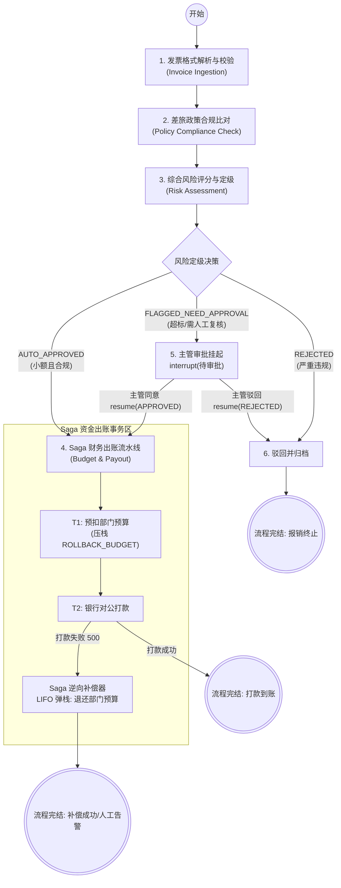

# 📋 企业级智能差旅报销与费用合规审计系统 (Enterprise Expense & Audit System)
## 需求规格说明书与架构蓝图 (PRD & System Blueprint)

---

## 一、 项目背景与行业对标 (Background & Industry Benchmark)

### 1.1 业务背景
在现代企业日常运营中，差旅与费用报销（T&E, Travel & Expense）是一项高频、刚需但极度繁琐的跨部门协作流程。
- **员工视角**：报销制度细则繁多（不同城市酒店上限不同、各类目餐饮餐补标准不同、周末加班报销需要凭据）。员工极易错填报销单，且往往需要经历长达数周的人工审批周期。
- **财务与合规视角**：财务人员每天需要肉眼核对数百张发票的真实性、比对员工职级与城市差旅限额，极度枯燥且容易漏审、误审。
- **管理层/CFO 视角**：存在假发票、连号发票、周末违规娱乐消费、部门预算超支等重大财务违规风险，往往在月末或季度结账时才被动暴露，造成资金损失。

### 1.2 工业参考标杆
本系统对标硅谷估值百亿美元的财务科技巨头 **Ramp** 与 **Brex** 的自主财务合规中台（Autonomous Expense Management & Accounts Payable Automation）：
> **核心定位**：彻底摆脱传统死板、人工审批的表单模式，利用 **LangGraph 状态机编排 + 政策规则/RAG 知识库检索 + 人机审批协同 (HITL) + Saga 资金事务补偿**，构建企业发票秒级审核、小额合规直接打款、异常高危实时拦截与审批的“自主财务审计智能体”。

---

## 二、 核心业务场景与功能需求 (Functional Requirements)

系统涵盖四大核心企业实战场景：

### 场景 1：小额日常合规报销 ——【秒级自动放行】
- **业务案例**：员工提交一张工作日市内打车发票（¥85.00）。
- **执行链路**：
  1. 系统解析发票要素（类目、金额、日期、城市、员工职级）；
  2. 匹配差旅政策：市内交通日限额 ¥150.00，金额合规；
  3. 综合风控评级：无任何风险点，且金额低于小额自动放行阈值（¥500.00）；
  4. 触发财务出款流水线：预扣部门预算 $\rightarrow$ 银行对公打款 $\rightarrow$ 报销完成，秒级到账。

### 场景 2：超标/大额差旅报销 ——【政策比对 + 人机审批挂起 (HITL)】
- **业务案例**：初级工程师出差北京，提交一张五星级酒店发票（¥750.00/晚）。
- **执行链路**：
  1. 系统解析发票，调取《差旅合规规章》：北京一级城市初级工程师住宿上限为 ¥450.00/晚；
  2. 政策评估引擎计算出：超标超额 ¥300.00；
  3. 综合判定结论：`FLAGGED_NEED_APPROVAL`（存在违规疑点，必须人工特批）；
  4. **状态机安全挂起**：调用 LangGraph `interrupt()` 原语暂停图的执行，生成《合规审计异常报告》，推送到部门主管审批后台；
  5. **主管审批恢复**：主管查验原委（如“出差展会周边房源紧张，特批实报实销”），通过 `Command(resume=...)` 唤醒图流转；
  6. 唤醒后继续执行财务 Saga 资金扣减与银行打款。

### 场景 3：严重违规发票 ——【规则硬核拦截与直接驳回】
- **业务案例**：员工提交一张周六晚上的高档餐厅发票（¥380.00），系统检测未关联任何周末加班审批单。
- **执行链路**：
  1. 系统识别发票日期为周末，且 `has_overtime_approval=False`；
  2. 触发《财务防欺诈红线规则》：非工作日餐饮报销必须提供加班凭据，否则判定为私费公报；
  3. 综合判定结论：`REJECTED`（严重违规，终止流程）；
  4. 系统记录违规审计日志，直接拒绝出款，终止图的生命周期。

### 场景 4：银行接口突发故障 ——【Saga 逆向补偿与预算退还】
- **业务案例**：主管同意了报销，但在向银行发起打款时，银行接口突发网络抖动或报 500 异常。
- **执行链路**：
  1. 财务出款正向事务：已在步骤 T1 成功预扣了技术部门差旅预算 ¥750.00；
  2. 步骤 T2 调用银行对公打款接口失败；
  3. **触发 Saga 逆向补偿拓扑**：根据状态中的 `compensation_stack`（LIFO 栈），倒序弹出补偿任务；
  4. 执行逆向撤销 C1：将 ¥750.00 原路退还至部门预算数据库；
  5. 记录财务死信告警并通知财务专员，保证企业系统内部账目**绝对平衡、零脏数据、零死账**。

---

## 三、 系统架构与技术实现方案 (Technical Architecture)

### 3.1 核心技术选型
| 技术维度 | 选型组件 | 核心作用 |
| :--- | :--- | :--- |
| **状态机与流控引擎** | **LangGraph 0.2+** | 节点流转、状态持久化、条件动态路由、动态断点 `interrupt()` |
| **数据契约与验证** | **Pydantic V2** | 发票格式严格校验、员工元数据防腐验证 |
| **政策评估引擎** | **阶段 1：规则解耦模块<br>阶段 2：向量 RAG 检索** | 阶段 1 用结构化规则跑通，阶段 2 平滑升级为 LangChain RAG 知识库检索 |
| **分布式资金事务** | **Saga 补偿模式 (LIFO)** | 解决跨微服务（预算库 + 银行接口）长事务一致性，防死账 |
| **开发与测试沙盒** | **Python 3.12+ / Pytest** | 零外部依赖沙盒模拟，自动化全场景单测 |

### 3.2 数据流与状态机拓扑图



---

## 四、 目录结构设计 (Clean Architecture 分层)

```text
enterprise_expense_system/
├── PROJECT_REQUIREMENTS.md            # 本需求规格说明书
├── README.md                          # 项目工程介绍
│
├── src/
│   ├── schemas/                       # 【领域契约层】
│   │   ├── invoice.py                 # 发票与员工的 Pydantic 模型 (Enums, InvoiceItem)
│   │   └── state.py                   # LangGraph 全局状态契约 (ExpenseAuditState)
│   │
│   ├── services/
│   │   ├── rules/                     # 【政策评估引擎 (解耦层)】
│   │   │   └── policy_checker.py      # [阶段1] 纯 Python 差旅规则计算
│   │   │                              # [阶段2] 无缝平替为 RAG 向量知识库检索
│   │   │
│   │   ├── saga/                      # 【财务事务层】
│   │   │   └── payout_service.py      # 部门预算扣减、银行打款与 LIFO 逆向补偿
│   │   │
│   │   └── agent/                     # 【LangGraph 编排引擎】
│   │       ├── nodes.py               # 业务节点函数 (解析、核验、风控、审批、出账)
│   │       ├── edges.py               # 动态条件路由函数
│   │       └── graph.py               # 状态图构建工厂 (compile)
│   │
│   └── api/                           # 【接口网关层 (后续扩展)】
│       └── main.py                    # FastAPI SSE 接口与 Webhook 审批恢复
│
└── tests/                             # 【测试验证沙盒】
    └── test_scenarios.py              # 4 大全真业务场景的端到端自动化测试
```

---

## 五、 项目实施里程碑规划 (Roadmap)

- [ ] **里程碑 1：领域数据契约建立（Schemas）**
  - 完成 `invoice.py`（发票与职级 Enum、Pydantic 校验模型）
  - 完成 `state.py`（LangGraph TypedDict 状态机契约设计）
- [ ] **里程碑 2：政策引擎与 Saga 出款服务（Services）**
  - 完成 `policy_checker.py`（多城市、多职级差旅规程计算）
  - 完成 `payout_service.py`（正向扣款与逆向补偿 LIFO 栈管理）
- [ ] **里程碑 3：LangGraph 状态机拓扑装配（Agent Core）**
  - 编排节点 `nodes.py`、条件边 `edges.py`
  - 实装 `interrupt()` 人工介入审批与 `Command(resume=...)` 唤醒
- [ ] **里程碑 4：全场景沙盒联调验收（Verification）**
  - 编写并跑通 4 大业务场景回归测试，验证数据零差错与状态原子性
- [ ] **里程碑 5：RAG 升级（Future Extension）**
  - 将 `policy_checker.py` 平滑替换为基于向量检索的企业 RAG 知识库
