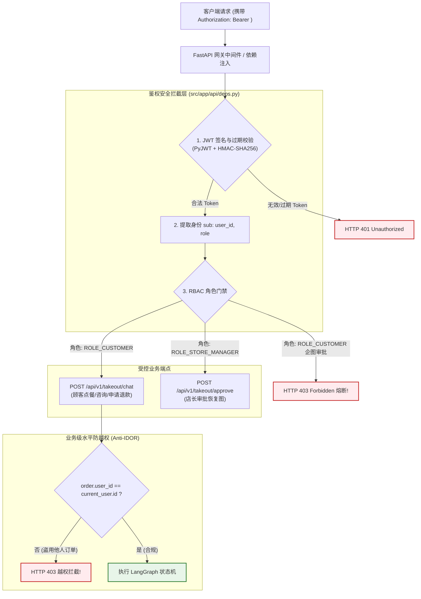

# 苍穹外卖智能体系统：权限隔离与 JWT 验签（RBAC 角色控制）实施方案

本文档制定了 `sky_takeout_system` 引入工业级 **RBAC（基于角色的访问控制）** 与 **JWT（JSON Web Token）无状态验签** 的完整实施方案，旨在彻底解决**接口未授权裸奔**、**大额退款审批被任意调用**以及**跨用户水平越权（IDOR）**等重大企业安全隐患。

---

## 1. 架构目标与威胁模型分析

---

## 2. 核心角色与权限矩阵（RBAC Matrix）

| 角色代码 | 角色定位 | 允许访问的端点 | 特殊数据隔离约束 |
| :--- | :--- | :--- | :--- |
| **`ROLE_CUSTOMER`** | 普通点餐顾客 | 1. `POST /takeout/chat` 2. `GET /auth/me` | **强制防水平越权**：系统自动将会话绑定为其真实 `user_id`；若传入 `order_id`，必须强校验该订单归属于本人，严禁查询或退款他人订单。 |
| **`ROLE_STORE_MANAGER`**| 门店店长 / 财务 | 1. `POST /takeout/approve` 2. `POST /takeout/chat` 3. `GET /auth/me` | 具备全店大额退款中断唤醒审批权限（`Command(resume=...)`）。 |

---

## 3. 详细落地里程碑与任务清单（Milestones）

```mermaid
gantt
    title RBAC & JWT 实施计划时序
    dateFormat X
    axisFormat %s
    section 基础设施
    依赖安装 (PyJWT + bcrypt)        :m1, 0, 1
    安全工具层 (security.py)        :m2, 1, 2
    section 领域数据
    User 模型与 Alembic 迁移         :m3, 2, 3
    种子账号数据注入                :m4, 3, 4
    section 网关与控制
    FastAPI 依赖注入 (deps.py)      :m5, 4, 5
    登录发券端点 (auth.py)          :m6, 5, 6
    受保护接口加固 (/chat & /approve) :m7, 6, 7
    section 验收
    端到端权限越权测试验证          :m8, 7, 8
```

### 里程碑 1：核心依赖与安全加密基础设施 (`src/app/core/security.py`)
1. 安装依赖：`pyjwt>=2.8.0`, `bcrypt>=4.1.0`；
2. 扩展配置 [`src/app/core/config.py`](file:///Users/anan/LearningPython/sky_takeout_system/src/app/core/config.py)：
   * `JWT_SECRET_KEY`: 高熵密钥（默认随机生成 32 字节 hex）；
   * `JWT_ALGORITHM`: `HS256`；
   * `ACCESS_TOKEN_EXPIRE_MINUTES`: 120 分钟；
3. 封装标准安全函数：
   * `verify_password(plain_password, hashed_password) -> bool`
   * `get_password_hash(password) -> str`
   * `create_access_token(data: dict, expires_delta: timedelta | None) -> str`
   * `decode_access_token(token: str) -> dict`

### 里程碑 2：用户领域实体与 Alembic 迁移 (`models/user.py`)
1. 创建模型 [`src/app/models/user.py`](file:///Users/anan/LearningPython/sky_takeout_system/src/app/models/user.py)：
   * `id`: BigInteger 主键；
   * `username`: String(64), 唯一索引；
   * `hashed_password`: String(128)；
   * `role`: String(32), 枚举值 `ROLE_CUSTOMER` / `ROLE_STORE_MANAGER`；
   * `user_identifier`: String(64), 业务标识（如 `USER_1001`）；
   * `status`: SmallInteger（1 正常，0 禁用）；
2. 执行 Alembic 版本化迁移：`alembic revision --autogenerate -m "create_users_table"` 并升级；
3. 更新 [`scripts/seed_data.sql`](file:///Users/anan/LearningPython/sky_takeout_system/scripts/seed_data.sql)，预置两个测试账号：
   * 顾客：`customer_alice` / 密码 `123456` / 绑定 `USER_1001` / 角色 `ROLE_CUSTOMER`
   * 店长：`manager_bob` / 密码 `123456` / 绑定 `MGR_8001` / 角色 `ROLE_STORE_MANAGER`

### 里程碑 3：权限依赖与登录发券端点 (`api/deps.py` & `api/v1/endpoints/auth.py`)
1. 封装通用依赖：
   * `get_current_user(token: str = Depends(oauth2_scheme)) -> User`：解析 Bearer Token，从 MySQL 查询用户实体，自动校验合法性与禁用状态；
   * `require_role(role: str)`：工厂依赖，校验用户是否具备指定权限；
2. 实现标准认证接口：
   * `POST /api/v1/auth/login`：接收账号密码，返回 `{ "access_token": "...", "token_type": "bearer", "role": "...", "user_id": "..." }`；
   * `GET /api/v1/auth/me`：查看当前登录用户元数据。

### 里程碑 4：核心端点加固与防越权改造 (`chat.py` & `approval.py`)
1. 加固 `/api/v1/takeout/chat`：
   * 注入 `current_user: User = Depends(get_current_user)`；
   * **消除身份冒用**：强制使用 `current_user.user_identifier` 覆盖请求体的 `user_id`；
   * **防水平越权检查**：若请求包含 `order_id`，查询 MySQL 检查 `order.user_id == current_user.user_identifier`，他人订单直接抛出 HTTP 403；
2. 加固 `/api/v1/takeout/approve`：
   * 注入 `current_user: User = Depends(require_role("ROLE_STORE_MANAGER"))`；
   * 任何持顾客 Token 的请求在**中间件/依赖层直接被 403 熔断**，保护资金安全。

### 里程碑 5：全链路集成与安全渗透测试 (`tests/test_rbac_gateway.py`)
编写自动化权限防御测试套件，覆盖：
* ❌ 测试 1：匿名无 Token 访问 `/chat` $\to$ 预期拦截为 **HTTP 401**；
* ❌ 测试 2：顾客 Alice 企图调用 `/approve` 恢复打款 $\to$ 预期拦截为 **HTTP 403 Forbidden**；
* ❌ 测试 3：顾客 Alice 企图查询 Bob 的订单 `ORD-TAKEOUT-9902` $\to$ 预期拦截为 **HTTP 403 越权保护**；
* ✅ 测试 4：顾客 Alice 正常咨询与查询本人订单 $\to$ 预期顺利流转（**HTTP 200**）；
* ✅ 测试 5：店长 Bob 登录并成功审批挂起退款 $\to$ 预期审批恢复成功（**HTTP 200**）。
