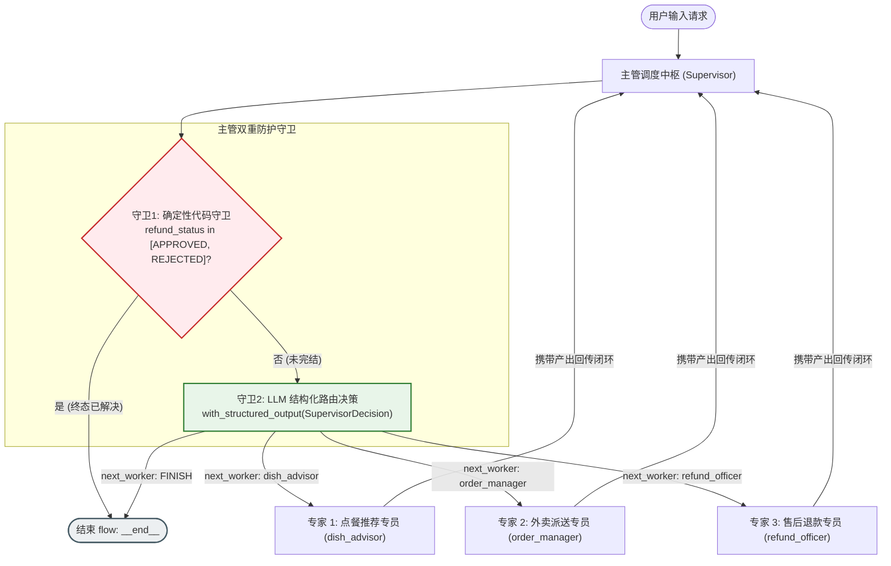
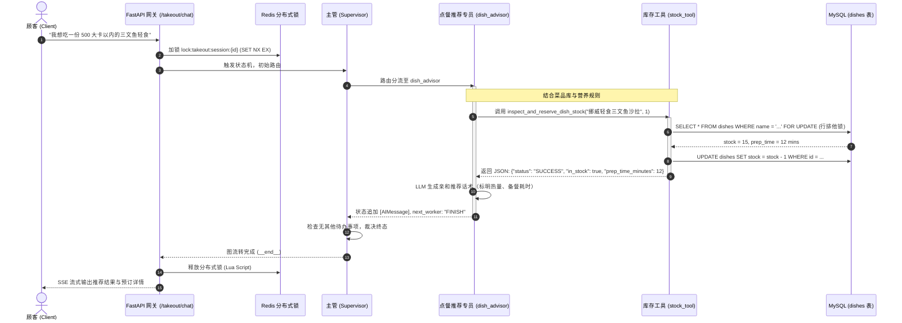
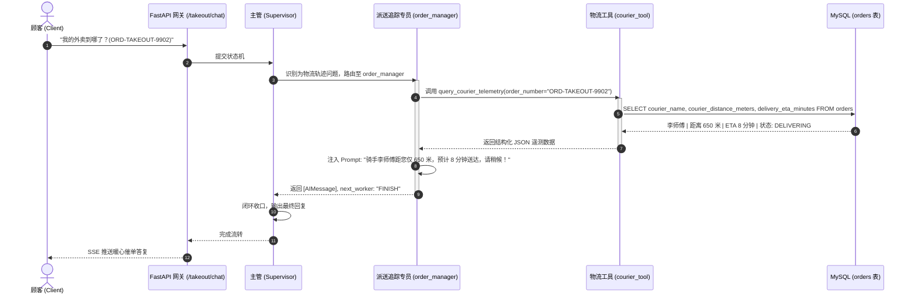
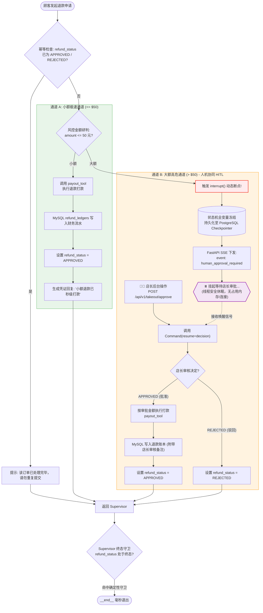
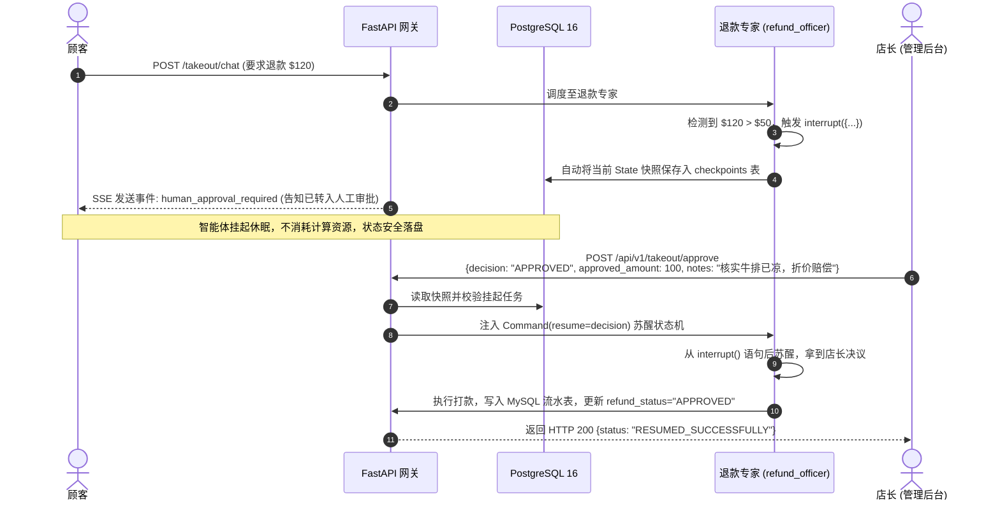

# 苍穹外卖智能体系统：架构拆分与三大专家（Experts）流程图解

本文档详细拆解了 `sky_takeout_system` 的系统架构，并分别为**点餐/下单推荐（Dish Advisor）**、**外卖派送/履约追踪（Order Manager）**以及**售后退款/动态人机审批（Refund Officer）**三大专员绘制了详细的执行流转图与核心设计说明。

---

## 1. 全局架构与调度中枢（Supervisor Architecture）

整个系统采用 **集中调度（Supervisor-Worker）模式** 与 **闭环裁决机制**。所有的用户请求统一由 `supervisor` 调度，每个专家处理完毕后必须**回传给 `supervisor` 形成闭环**，避免分支逃逸。

> [!TIP]
> **主管的“确定性短路守卫”设计**：
> 在 [`supervisor.py`](file:///Users/anan/LearningPython/sky_takeout_system/src/app/services/agent/supervisor.py#L18-L24) 中，当订单状态已为 `APPROVED` 或 `REJECTED` 时，直接返回 `FINISH`，**不消耗任何大模型 Token，耗时 0ms**，彻底杜绝了大模型在闭环时容易陷入的“死循环分流”。

---

## 2. 专家一：点餐推荐与库存预占（Dish Advisor）

负责处理用户的餐品推荐、热量预算、菜系偏好，并具备真实查询与预占后厨库存的能力。

### 关键代码落地
* 业务入口：[`src/app/services/agent/specialists/dish_advisor.py`](file:///Users/anan/LearningPython/sky_takeout_system/src/app/services/agent/specialists/dish_advisor.py)
* 数据库工具：[`src/app/services/agent/tools/stock_tool.py`](file:///Users/anan/LearningPython/sky_takeout_system/src/app/services/agent/tools/stock_tool.py)
* 仓储层事务行锁：[`src/app/repositories/dish_repo.py`](file:///Users/anan/LearningPython/sky_takeout_system/src/app/repositories/dish_repo.py#L22-L35)

---

## 3. 专家二：外卖派送与实时履约追踪（Order Manager）

负责处理用户的催单、骑手位置询问、预计到达时间（ETA）计算，查询真实物流传感器数据并安抚顾客。

### 关键代码落地
* 业务入口：[`src/app/services/agent/specialists/order_manager.py`](file:///Users/anan/LearningPython/sky_takeout_system/src/app/services/agent/specialists/order_manager.py)
* 数据库工具：[`src/app/services/agent/tools/courier_tool.py`](file:///Users/anan/LearningPython/sky_takeout_system/src/app/services/agent/tools/courier_tool.py)
* 仓储查询：[`src/app/repositories/order_repo.py`](file:///Users/anan/LearningPython/sky_takeout_system/src/app/repositories/order_repo.py#L12-L18)

---

## 4. 专家三：售后退款与人机协同审批（Refund Officer）

这是整个系统**设计最精妙、最具企业实战价值**的专家模块，融合了**大小额分流、动态人工介入断点（Human-in-the-Loop Interrupt）、状态冻结保存与唤醒恢复、以及财务账本数据库级幂等防重写**。

### 大额退款中断与苏醒的时序交互

### 关键代码落地
* 核心断点与苏醒逻辑：[`src/app/services/agent/specialists/refund_officer.py`](file:///Users/anan/LearningPython/sky_takeout_system/src/app/services/agent/specialists/refund_officer.py#L39-L68)
* 人工审批恢复端点：[`src/app/api/v1/endpoints/approval.py`](file:///Users/anan/LearningPython/sky_takeout_system/src/app/api/v1/endpoints/approval.py#L9-L47)
* 财务流水幂等落库：[`src/app/repositories/refund_repo.py`](file:///Users/anan/LearningPython/sky_takeout_system/src/app/repositories/refund_repo.py#L13-L58)

---

## 5. 架构核心收益对照表

| 维度 | 单文件/Toy Code 实现 | 本工程生产级解耦实现 |
| :--- | :--- | :--- |
| **数据源** | 内存字典 `global dishes = {}` | 真实 **MySQL 8.0**，Alembic 版本化迁移，行级排他锁 |
| **状态持久化**| 内存 `MemorySaver`（重启即丢） | **PostgreSQL 16** `AsyncPostgresSaver` 连接池，崩溃不丢断点 |
| **并发防护** | `asyncio.Lock()`（仅防单进程） | **Redis 全局分布式锁**，毫秒防抖，集群多副本安全互斥 |
| **人工介入** | 控制台 input() 阻塞主线程 | 原生 **`interrupt()` + `Command(resume=...)`** 异步非阻塞挂起 |
| **流式交互** | 简单字符串拼接返回 | **FastAPI SSE** 复合事件流（节点流转、打字机输出、风控告警） |
| **拓扑流转** | 大模型随意跳转，容易死循环 | **主管双守卫**：确定性业务终态 0ms 短路，彻底杜绝死循环 |
